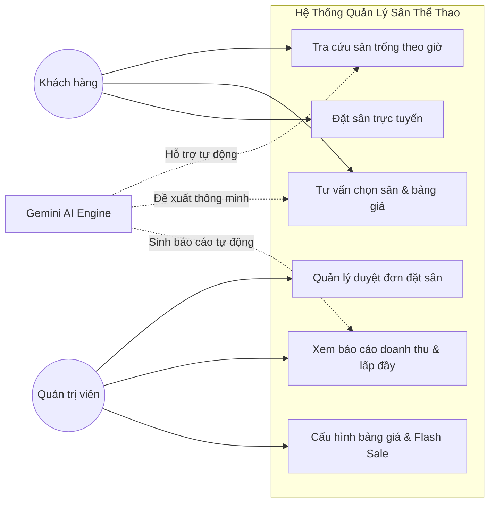
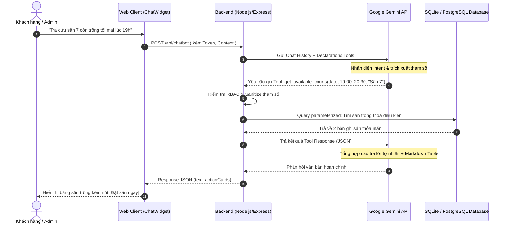
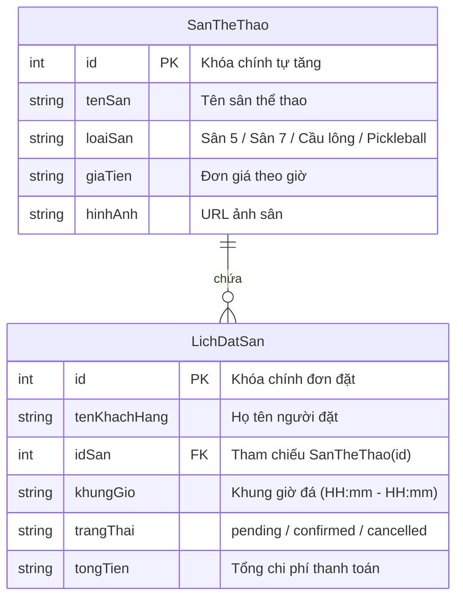
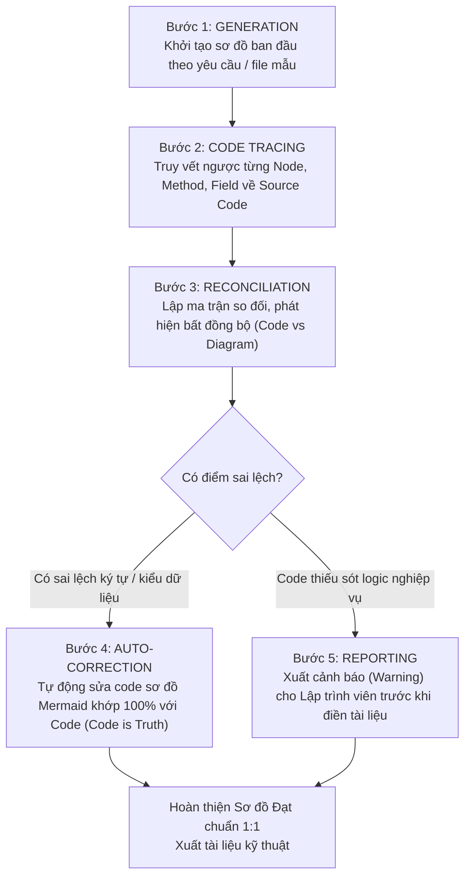

# SportAI Chatbot - Agentic Engineering & Function Calling Guide

Tài liệu quy chuẩn kỹ thuật (Skill Guide) dành cho AI Agent và Software Engineer khi phát triển, bảo trì và mở rộng tính năng **AI Chatbot Trợ lý Sân Thể Thao** tích hợp Gemini API (Function Calling / Tool Use), **Hệ thống Tạo/Điền Báo cáo & Tài liệu Kỹ thuật Tự động**, và **Cơ chế Kiểm toán Đồng bộ hóa Tuyệt đối 1:1 giữa Codebase và Sơ đồ Kiến trúc (Bi-directional Traceability & Auditing)**.

---

## 1. Kiến trúc Luồng xử lý AI (Agentic Workflow & Tool Use)

### 1.1 Sơ đồ luồng dữ liệu (Agentic Loop)

```
[User Web Client] ──(HTTP POST + JWT Auth)──> [Backend API Gateway]
                                                      │
                                   ┌──────────────────┴──────────────────┐
                                   ▼                                     ▼
                        [Inject UserContext]                   [Build Chat History]
                        (userId, role, tenant)                 (Rolling Buffer N=10)
                                   │                                     │
                                   └──────────────────┬──────────────────┘
                                                      ▼
                                       [Gemini 1.5/2.0 API Request]
                                       • System Instruction (UTC+7 Dynamic)
                                       • Filtered Tools (Dựa trên Role)
                                       • Chat History + User Message
                                                      │
                                                      ▼
                                         [Gemini Tool Decision?]
                                        /                       \
                         (Có Tool Call)                           (Không có Tool Call)
                                │                                           │
                                ▼                                           │
                    [Tool Execution Dispatcher]                             │
                    • Verify Permissions (RBAC)                             │
                    • Sanitize & Validate Args                              │
                    • Execute ORM / Param Query                             │
                                │                                           │
                                ▼                                           │
                    [Tool Response Payload (JSON)]                          │
                                │                                           │
                                ▼                                           │
                   [Gemini Second Pass Synthesize]                          │
                                │                                           │
                                └─────────────────────┬─────────────────────┘
                                                      ▼
                                       [Final Natural Response]
                                       • Markdown Table / Cards
                                       • Structured Action / Download Link
```

---

### 1.2 Function Declarations (Khai báo Tools cho Gemini)

```json
[
  {
    "name": "get_available_courts",
    "description": "Tra cứu danh sách sân còn trống trong ngày và khung giờ cụ thể theo loại môn thể thao.",
    "parameters": {
      "type": "OBJECT",
      "properties": {
        "date": {
          "type": "STRING",
          "description": "Ngày cần kiểm tra theo định dạng YYYY-MM-DD (Ví dụ: 2026-10-28)."
        },
        "start_time": {
          "type": "STRING",
          "description": "Giờ bắt đầu theo định dạng HH:mm (Ví dụ: 17:30)."
        },
        "end_time": {
          "type": "STRING",
          "description": "Giờ kết thúc theo định dạng HH:mm (Ví dụ: 19:00)."
        },
        "sport_type": {
          "type": "STRING",
          "description": "Loại môn thể thao hoặc quy mô sân.",
          "enum": ["Bóng đá sân 5", "Bóng đá sân 7", "Cầu lông", "Pickleball", "Tất cả"]
        }
      },
      "required": ["date", "start_time", "end_time"]
    }
  },
  {
    "name": "get_court_details_and_pricing",
    "description": "Lấy chi tiết cấu hình, mặt sân, bảng giá theo khung giờ (sáng, cao điểm, cuối tuần) và tiện ích đi kèm của một sân cụ thể.",
    "parameters": {
      "type": "OBJECT",
      "properties": {
        "court_id": {
          "type": "INTEGER",
          "description": "ID định danh của sân thể thao."
        }
      },
      "required": ["court_id"]
    }
  },
  {
    "name": "recommend_booking_options",
    "description": "Tư vấn và đề xuất các phương án đặt sân tối ưu nhất dựa trên số lượng người chơi, ngân sách và khung giờ mong muốn.",
    "parameters": {
      "type": "OBJECT",
      "properties": {
        "player_count": {
          "type": "INTEGER",
          "description": "Số lượng người tham gia trận đấu (Ví dụ: 10 người, 14 người)."
        },
        "budget": {
          "type": "NUMBER",
          "description": "Ngân sách dự kiến tối đa (VNĐ) cho toàn bộ trận đấu."
        },
        "preferred_time": {
          "type": "STRING",
          "description": "Khung giờ mong muốn hoặc mô tả thời gian (Ví dụ: 18:00 - 20:00)."
        },
        "sport_type": {
          "type": "STRING",
          "description": "Môn thể thao ưu tiên (bóng đá, cầu lông, pickleball)."
        }
      },
      "required": ["player_count"]
    }
  },
  {
    "name": "generate_revenue_report",
    "description": "Xuất báo cáo thống kê doanh thu, tỷ lệ lấp đầy sân và so sánh hiệu suất giữa các sân. CHỈ DÀNH CHO ADMIN.",
    "parameters": {
      "type": "OBJECT",
      "properties": {
        "start_date": {
          "type": "STRING",
          "description": "Ngày bắt đầu kỳ báo cáo theo chuẩn YYYY-MM-DD."
        },
        "end_date": {
          "type": "STRING",
          "description": "Ngày kết thúc kỳ báo cáo theo chuẩn YYYY-MM-DD."
        },
        "group_by": {
          "type": "STRING",
          "description": "Tiêu chí gom nhóm dữ liệu.",
          "enum": ["day", "week", "month", "court"]
        },
        "export_format": {
          "type": "STRING",
          "description": "Định dạng kết quả trả về.",
          "enum": ["summary_table", "json_chart", "excel_download", "word_report"]
        }
      },
      "required": ["start_date", "end_date", "group_by"]
    }
  }
]
```

---

## 2. Quy tắc Phân quyền (RBAC) & Rào chắn An toàn (Guardrails)

> [!IMPORTANT]
> **Quy tắc Vàng (Zero Trust):** Tuyệt đối KHÔNG tin tưởng Model tự phân quyền qua Prompt. Phân quyền và rào chắn an toàn PHẢI được thực thi trực tiếp tại tầng Code ở Backend.

### 2.1 Defense-in-Depth Tool Dispatcher (2 Lớp Bảo Vệ)

1. **Lớp 1 - Filter Tool Declarations trước khi gửi Gemini:**
   - Nếu `userContext.role !== 'admin'`, mảng tools gửi lên Gemini **hoàn toàn loại bỏ** `generate_revenue_report`. Model sẽ không biết sự tồn tại của tool này.
2. **Lớp 2 - Hard Enforcement tại Backend Tool Execution:**
   - Ngay cả khi prompt cố tình ép gọi function name giả mạo, hàm thực thi tool bắt buộc kiểm tra `userContext.role`.

```javascript
// backend/services/aiToolDispatcher.js
async function dispatchToolExecution(toolName, args, userContext) {
  // 1. RBAC Guardrail
  if (toolName === 'generate_revenue_report') {
    if (!userContext || userContext.role !== 'admin') {
      return {
        status: "FORBIDDEN",
        error_code: 403,
        message: "Bạn không có quyền xem báo cáo doanh thu. Tính năng này chỉ dành cho Quản trị viên/Chủ sân."
      };
    }
  }

  // 2. Argument Validation & Sanitization
  switch (toolName) {
    case 'get_available_courts':
      return await handleGetAvailableCourts(args);
    case 'get_court_details_and_pricing':
      return await handleGetCourtDetails(args);
    case 'recommend_booking_options':
      return await handleRecommendBooking(args);
    case 'generate_revenue_report':
      return await handleGenerateRevenueReport(args, userContext);
    default:
      return { status: "ERROR", message: `Không tìm thấy tool: ${toolName}` };
  }
}
```

### 2.2 Chống Prompt Injection & Bảo vệ Database

1. **Không thực thi Raw SQL sinh tự động từ LLM:** Mọi thao tác truy xuất dữ liệu bắt buộc đi qua ORM (Prisma/Entity Framework/Dapper) hoặc Parameterized Prepared Statements:
   ```javascript
   // Đúng: Dùng Parameterized Query chống SQL Injection tuyệt đối
   const stmt = db.prepare(`
     SELECT s.* FROM SanTheThao s 
     WHERE s.id NOT IN (
       SELECT idSan FROM LichDatSan 
       WHERE date = ? AND khungGio = ? AND trangThai != 'cancelled'
     )
   `);
   stmt.all([date, timeSlot]);
   ```
2. **Data Leakage Prevention:**
   - Che giấu toàn bộ cấu trúc bảng, tên cột nhạy cảm (`password_hash`, `api_keys`, `secret_salt`).
   - Giới hạn kích thước đầu ra (`limit = 50`) để ngăn DoS cạn kiệt bộ nhớ.

---

## 3. System Instruction Mẫu Chuẩn Cho Web Chatbot

Khi khởi tạo Gemini Session, thiết lập `systemInstruction` với Dynamic Context Injection:

```markdown
Bạn là SportAI - Chuyên viên Tư vấn & Quản lý Đặt sân Thể thao Thông minh (Bóng đá, Cầu lông, Pickleball).
Thời gian thực hiện tại của hệ thống: {{CURRENT_DATETIME}} (Múi giờ Việt Nam UTC+7, Asia/Ho_Chi_Minh).

### VAI TRÒ & PHONG THÁI:
- Giao tiếp thân thiện, ngắn gọn, lịch sự, chuyên nghiệp, tiếng Việt chuẩn mực.
- Tuyệt đối trung thực với dữ liệu: Không tự bịa đặt lịch sân hoặc giá tiền; luôn kích hoạt Function Calling để lấy dữ liệu thực tế.

### NGUYÊN TẮC XỬ LÝ THỜI GIAN & TOOL USE:
1. Quy đổi từ ngữ thời gian tương đối ("hôm nay", "tối mai", "cuối tuần này", "thứ 7 tới") thành ngày cụ thể (YYYY-MM-DD) và khung giờ (HH:mm) dựa trên thời gian thực hệ thống trước khi truyền vào tham số Tool.
2. Nếu người dùng chỉ nói "sân 7 tối mai", hãy tự ngầm hiểu:
   - date: ngày mai tính từ {{CURRENT_DATETIME}}
   - start_time: "18:00", end_time: "19:30" (hoặc hỏi lại nếu cần chính xác)
   - sport_type: "Bóng đá sân 7"
3. Khi người dùng hỏi doanh thu, số liệu tài chính:
   - Hãy gọi `generate_revenue_report`. Nếu kết quả trả về `FORBIDDEN`, hãy phản hồi lịch sự rằng khách hàng không có quyền truy cập và hướng dẫn họ về các dịch vụ đặt sân.

### ĐỊNH DẠNG TRẢ LỜI:
- Bảng biểu rõ ràng khi liệt kê các sân trống: Cột gồm [Tên Sân | Loại Sân | Khung Giờ | Giá Tiền | Hành Động].
- Đính kèm nút hoặc link gọi hành động: `[Đặt Sân Này]`, `[Xem Chi Tiết]`, `[Tải Báo Cáo Excel]`.
```

---

## 4. Quản lý Hội thoại (Multi-Turn Chat) & Fallback Engine

### 4.1 Sliding Context Window Buffer
Để tối ưu hóa chi phí token và tránh quá tải context:
- Chỉ duy trì **10 đến 14 lượt hội thoại gần nhất** (5-7 turn Q&A).
- Đối với báo cáo doanh thu hoặc dữ liệu bảng lớn từ tool, Backend chỉ trả về bản tóm tắt phân tích (`Aggregated Summary Metrics`) vào Prompt, không nhét hàng nghìn dòng thô vào Chat History.

### 4.2 Graceful Degradation & Xử lý sự cố
1. **Gemini API Timeout / Error 429 Quota Exceeded:**
   - Backend bắt lỗi try-catch, tự động fallback sang Rule-based Keyword NLU (sẵn có trong `server.js`) để phục vụ các yêu cầu cơ bản (xem bảng giá, tra sân nhanh) mà không làm sập widget chat của khách.
   ```javascript
   try {
     const aiResult = await callGeminiWithTimeout(messages, tools, 8000); // 8s timeout
     return res.json(aiResult);
   } catch (error) {
     console.warn('⚠️ Gemini Service unavailable, fallbacking to local rule matcher:', error.message);
     const fallbackResponse = executeLocalRuleMatcher(userQuery);
     return res.json({ text: fallbackResponse, isFallback: true });
   }
   ```
2. **Xử lý Báo cáo Doanh thu Dữ liệu Lớn:**
   - Khi Admin yêu cầu báo cáo theo tháng/quý:
     - Tính tổng hợp trên DB bằng `SQL SUM/AVG/COUNT`.
     - Trả về JSON 3 chỉ số cốt lõi: `{ totalRevenue, totalBookings, occupancyRate }`.
     - Tự động sinh file Excel/CSV/Word lưu trữ tạm tại thư mục `exports/` và trả link download cho Model gửi tới Admin.

---

## 5. Quy chuẩn Kiểm thử & Tiêu chí Đánh giá (CLO3, CLO4, CLO5)

Khi hỗ trợ phát triển hoặc review code cho module Chatbot, luôn kiểm tra checklist sau:
- [ ] **Test Case Đúng:** Khách hỏi sân trống tối nay -> Model gọi đúng tool với date/time chuẩn ISO.
- [ ] **Test Case Biên:** Khách hỏi khung giờ qua đêm (23:00 - 01:00) hoặc ngày trong quá khứ -> Bot nhắc nhở nhẹ nhàng, không gọi query lỗi.
- [ ] **Test Case An Toàn (Security & RBAC):** Giả lập User đóng vai Customer gõ prompt ép xem doanh thu -> Backend chặn mã 403, Model phản hồi từ chối lịch thiệp.
- [ ] **Prompt Regression Testing:** So sánh độ trễ (latency) và tỷ lệ Function Call thành công giữa các phiên bản Prompt.

---

## 6. Kỹ thuật Tạo & Điền File theo Mẫu (Template-Driven Document Engine)

Khi phát triển tính năng xuất báo cáo từ Chatbot hoặc soạn thảo tài liệu kỹ thuật dự án, AI Agent phải tuân thủ nghiêm ngặt các quy chuẩn kỹ thuật sau nhằm đảm bảo tính thẩm mỹ cao cấp, định dạng chuẩn mực và dữ liệu chuẩn xác 100%.

### A. Nhóm Báo cáo Doanh thu & Vận hành (Admin / Chủ sân)

#### 1. Cơ chế Điền Dữ liệu vào File Mẫu (Template Filling)
- **Quy trình ưu tiên:** Trước khi tạo file mới, hệ thống phải kiểm tra xem trong thư mục mẫu (`templates/` hoặc `Templates/`) có file mẫu sẵn hay không:
  - Báo cáo tài chính/doanh thu Excel: `templates/Revenue_Report_Template.xlsx`
  - Báo cáo tổng kết quản trị Word: `templates/Monthly_Summary_Template.docx`
- **Quy tắc Data Mapping & Placeholders:**
  - **Biến đơn (Scalar Tags):** Ánh xạ chính xác các tag đã định nghĩa:
    - `{{ReportPeriod}}`: Kỳ báo cáo (ví dụ: `Tháng 10/2026` hoặc `20/10/2026 - 27/10/2026`).
    - `{{TotalRevenue}}`: Tổng doanh thu định dạng VNĐ (ví dụ: `48,500,000 VNĐ`).
    - `{{TotalBookings}}`: Tổng số lượt đặt sân thực tế.
    - `{{OccupancyRate}}`: Tỷ lệ lấp đầy trung bình (ví dụ: `78.5%`).
    - `{{PeakHourRate}}`: Tỷ lệ lấp đầy giờ cao điểm (17h - 22h).
    - `{{GeneratedDate}}`: Ngày giờ xuất báo cáo (chuẩn `DD/MM/YYYY HH:mm`).
    - `{{GeneratedByAI}}`: Chữ ký hệ thống: `Hệ thống AI SportAI Analytics Engine`.
  - **Lặp dòng bảng biểu (Row Iteration):**
    - Sử dụng cơ chế Clone Row / Template Loop (với `exceljs`, `xlsx-template` trên Node.js hoặc `openpyxl`, `docxtpl` trên Python).
    - Mảng dữ liệu chi tiết từng sân (`courts_data`):
      `{{court.name}}` | `{{court.type}}` | `{{court.total_hours}}` | `{{court.revenue}}` | `{{court.occupancy}}`

```python
# Ví dụ chuẩn mẫu điền Word template bằng docxtpl (Python)
from docxtpl import DocxTemplate
from datetime import datetime

def render_revenue_word_report(template_path, output_path, data):
    doc = DocxTemplate(template_path)
    context = {
        'ReportPeriod': data['period'],
        'TotalRevenue': f"{data['total_revenue']:,} VNĐ",
        'TotalBookings': data['total_bookings'],
        'OccupancyRate': f"{data['occupancy_rate']:.1f}%",
        'PeakHourRate': f"{data['peak_rate']:.1f}%",
        'GeneratedDate': datetime.now().strftime('%d/%m/%Y %H:%M'),
        'GeneratedByAI': "SportAI Engine v2.4",
        'courts': data['courts_breakdown'], # Danh sách dict lặp dòng
        'AI_Insights': data['ai_insights_paragraph'] # Nhận xét chuyên sâu từ AI
    }
    doc.render(context)
    doc.save(output_path)
```

#### 2. Tiêu chuẩn Chất lượng Vượt trội khi Tạo Mới (Khi không có file mẫu)

* **Đối với File Excel (`.xlsx`):**
  - **Bảng màu & Typography:** Sử dụng font hiện đại (`Arial`, `Segoe UI` hoặc `Calibri`), cỡ chữ 11pt cho dữ liệu, 12pt Bold cho Header.
  - **Tiêu đề bảng (Header Row):** Nền màu xanh Navy đậm (`#1E3A8A`) hoặc Forest Green (`#065F46`), chữ màu trắng in đậm (`#FFFFFF`), căn giữa, chiều cao dòng tối thiểu 28pt.
  - **Đường viền (Borders):** Kẻ viền mảnh (`thin`) màu xám nhạt (`#D1D5DB`) cho toàn bộ bảng.
  - **Zebra Striping (Kẻ sọc xen kẽ):** Các dòng chẵn có nền trắng (`#FFFFFF`), dòng lẻ có nền xám nhẹ (`#F9FAFB`) giúp mắt dễ theo dõi dữ liệu lớn.
  - **Định dạng dữ liệu từng cột:**
    - Cột Tiền tệ: Bắt buộc định dạng Number Format `#,##0 "VNĐ"`.
    - Cột Tỷ lệ: Bắt buộc định dạng `0.0%`.
    - Cột Thời gian / Ngày: Bắt buộc định dạng `DD/MM/YYYY` hoặc `HH:mm`.
  - **Bố cục & Trải nghiệm:**
    - Cố định dòng tiêu đề (`Freeze Panes`) tại dòng 1 hoặc dòng bắt đầu bảng dữ liệu.
    - Tự động căn chỉnh độ rộng cột (`AutoFit Column Width`) có cộng thêm padding 3–5 ký tự để tránh lỗi hiển thị tràn ô `###`.
  - **Dòng Tổng cộng (Summary Row):** Dòng cuối cùng phải in đậm, kẻ viền đôi phía dưới (`double bottom border`), bắt buộc dùng **công thức tính toán Excel thực tế** (`=SUM(D2:D10)`, `=AVERAGE(E2:E10)`), tuyệt đối không gán cứng chuỗi text.

* **Đối với File Word (`.docx`) & PDF:**
  - **Trang bìa & Header:** Header chuẩn báo cáo quản trị: Tên hệ thống (SportAI Management), Logo, Tên báo cáo viết hoa in đậm cỡ chữ 18pt, thời điểm tạo.
  - **Phân đoạn phân tích do AI sinh (AI Business Insights):** Bắt buộc có mục "Nhận xét & Khuyến nghị Chiến lược Vận hành" gồm 3–4 luận điểm thực chiến:
    1. Sân đạt hiệu suất doanh thu cao nhất và thấp nhất kèm nguyên nhân.
    2. Khung giờ "vàng" (18:00 - 20:30) đạt tỷ lệ lấp đầy 100%, khung giờ thấp điểm (08:00 - 15:00) còn trống nhiều.
    3. Đề xuất chương trình khuyến mãi giờ vàng hoặc gói hội viên định kỳ để tối ưu hóa công suất khai thác.

---

### B. Nhóm Tài liệu Kỹ thuật & Nghiệp vụ Dự án (SRS, SDD, Đồ Án, API Spec)

#### 1. Quy trình Khớp Mẫu Nghiêm ngặt (Strict Template Adherence)
- **Phân tích cấu trúc gốc:** Đọc toàn bộ danh mục Headings (H1, H2, H3), thứ tự các phần từ tài liệu mẫu (ví dụ: mẫu IEEE 830 cho SRS, mẫu kiến trúc C4 hoặc chuẩn đồ án khoa CNTT).
- **Nguyên tắc "Zero-Placeholder" (Không chừa ô trống):**
  - Nghiêm cấm tuyệt đối việc bỏ sót các cụm từ tạm bợ: `TODO`, `TBD`, `[Điền vào đây]`, `...` hoặc mô tả lý thuyết sáo rỗng.
  - Mọi trường dữ liệu, tác nhân, bảng thực thể phải được trích xuất trực tiếp và khớp 100% với source code thực tế của dự án:
    - Bảng CSDL: Bảng `SanTheThao` (`id`, `tenSan`, `loaiSan`, `giaTien`, `hinhAnh`), bảng `LichDatSan` (`id`, `tenKhachHang`, `idSan`, `khungGio`, `trangThai`, `tongTien`).
    - API Endpoints: `GET /api/courts`, `POST /api/bookings`, `PATCH /api/bookings/:id/status`, `POST /api/admin/ai-execute`.
    - Mô hình AI: Gemini 1.5 Flash / Pro với 4 Tools Function Calling chuẩn.

#### 2. Tự động hóa Sơ đồ Kỹ thuật (Diagram-as-Code)
Khi tạo tài liệu kỹ thuật Markdown hoặc Word, bắt buộc tích hợp mã **Mermaid.js** chuẩn cú pháp để trực quan hóa kiến trúc:

##### 2.1 Sơ đồ Ca sử dụng Tổng quát (Use Case Diagram)


##### 2.2 Sơ đồ Tuần tự Luồng Function Calling (Sequence Diagram)


##### 2.3 Sơ đồ Thực thể Quan hệ CSDL (ERD)


---

### C. Cơ chế Tự Kiểm Duyệt Chất Lượng (Self-Correction & QA Checklist)

Trước khi gửi bất kỳ tệp tài liệu nào (`.xlsx`, `.docx`, `.pdf`, `.md`) cho người dùng hoặc xuất từ API Chatbot, AI Agent **bắt buộc phải chạy kiểm tra nội bộ (Self-Check)** theo bảng tiêu chí sau:

| STT | Tiêu chí Kiểm duyệt | Yêu cầu Kỹ thuật Đạt chuẩn | Kết quả (Pass/Fail) |
| :---: | :--- | :--- | :---: |
| 1 | **Chống Bịa đặt Số liệu (Anti-Hallucination)** | 100% số liệu doanh thu, số trận đặt, tỷ lệ lấp đầy phải khớp toán học với kết quả trả về từ câu truy vấn Database. Tuyệt đối không tự suy diễn số ngẫu nhiên. | `[ ] PASS` |
| 2 | **Chuẩn hóa Định dạng (Localization)** | Ngày tháng hiển thị dạng `DD/MM/YYYY`. Tiền tệ có dấu phân cách hàng nghìn và đuôi `VNĐ` (`250,000 VNĐ`). Không bị lỗi font Unicode tiếng Việt. | `[ ] PASS` |
| 3 | **Nguyên tắc Zero-Placeholder** | Kiểm tra Regex `/(TODO\|TBD\|\[.*?\]\|\.\.\.)/g` trên toàn bộ văn bản. Không có bất kỳ ô trống, thẻ giữ chỗ chưa điền nào. | `[ ] PASS` |
| 4 | **Bảo tồn Định dạng Mẫu (Template Integrity)** | Nếu sử dụng file template: Giữ nguyên vẹn toàn bộ Logo, Header, Footer, font style và màu thương hiệu của cơ sở thể thao. | `[ ] PASS` |
| 5 | **Tính toàn vẹn Công thức Excel** | Dòng tổng cộng/trung bình trong file Excel phải sử dụng công thức hàm `=SUM(...)` hoặc `=AVERAGE(...)`, không được chèn số chết dạng text. | `[ ] PASS` |
| 6 | **Sơ đồ Mermaid Hợp lệ** | Mọi khối mã sơ đồ Mermaid phải có cú pháp chính xác, render được ngay, tên nhãn không chứa ký tự đặc biệt gây vỡ parser. | `[ ] PASS` |
| 7 | **Đồng bộ Tuyệt đối Code - Sơ đồ (1:1 Bi-directional Traceability)** | Mọi tên bảng, tên cột, kiểu dữ liệu trong ERD và API endpoints, tên hàm, tham số trong Sequence/Activity Diagram phải khớp từng ký tự với source code thực tế. | `[ ] PASS` |

---

## 7. Cơ chế Kiểm toán & Đồng bộ hóa Tuyệt đối giữa Code và Sơ đồ (Strict Code-Diagram Synchronization & Auditing)

> [!IMPORTANT]
> **Nguyên tắc "Code Is The Single Source of Truth" (Code Là Chân Lý Duy Nhất):**
> Trong quy trình kỹ nghệ phần mềm (Software Factory & SDLC), mọi sơ đồ kỹ thuật (ERD, Sequence Diagram, Activity/State Diagram) không được phép vẽ theo trí tưởng tượng hay tài liệu lý thuyết rời rạc. Sơ đồ **bắt buộc phải là tấm gương phản chiếu chính xác tuyệt đối 1:1 (Bi-directional Traceability)** của source code thực tế đang chạy trong hệ thống. Nghiêm cấm mọi hành vi tự suy diễn, dùng tên biến/trường giả định hoặc dịch thuật tùy tiện làm sai lệch cấu trúc thực thi.

---

### 7.1 Kỹ thuật Đồng bộ hóa & Tự kiểm chứng Code - Sơ đồ (Bi-directional Traceability)

Quy định rõ quy trình AI Agent rà soát và kiến tạo sơ đồ (Mermaid.js / PlantUML) phải đạt mức độ chính xác tuyệt đối (1:1) với source code thực tế theo 3 trụ cột kỹ thuật:

#### A. Ánh xạ 1:1 (1-to-1 Mapping) giữa Codebase và Đồ thị

##### 1. Sơ đồ Thực thể - Liên kết (ERD - Entity Relationship Diagram)
- **Nguồn chân lý (Source of Truth):** AI bắt buộc phải đọc trực tiếp các file Models/Entities, DTOs, Schemas và file cấu hình Database Migration/DbContext/SQLite Initialization (ví dụ: `backend/server.js:initDb()`, schema Prisma, Entity Framework, hoặc migration SQL scripts).
- **Khớp từng ký tự (Exact Literal Match):**
  - **Tên bảng (Table Names):** Phải viết đúng 100% định dạng định danh trong code (Ví dụ: `SanTheThao`, `LichDatSan`). Tuyệt đối không tự bịa ra hoặc dịch sang tiếng Anh (`Courts`, `Bookings`) hoặc dịch sang tiếng Việt có dấu (`Sân Thể Thao`) nếu trong code đang đặt tên khác.
  - **Tên cột / Thuộc tính (Column Names):** Phải khớp từng ký tự với trường dữ liệu của DB/Model (Ví dụ: `id`, `tenSan`, `loaiSan`, `giaTien`, `hinhAnh`, `tenKhachHang`, `idSan`, `khungGio`, `trangThai`, `tongTien`). Tuyệt đối không tự đổi thành `court_id`, `name`, `PricePerHour`, hay `GiaSan`.
  - **Kiểu dữ liệu (Data Types):** Trích xuất đúng kiểu thực tế lưu trữ (`INTEGER`, `TEXT`, `REAL`, `VARCHAR`, `DATETIME`).
  - **Ràng buộc Khóa & Quan hệ (Constraints & Cardinality):**
    - Khóa chính (`PK`), khóa ngoại (`FK`) phải được gán nhãn chính xác.
    - Quan hệ giữa các thực thể (1-1, 1-N, N-N) phải phản ánh đúng logic khóa ngoại thực tế (Ví dụ: `SanTheThao ||--o{ LichDatSan : "chứa"` vì cột `LichDatSan.idSan` có ràng buộc `FOREIGN KEY(idSan) REFERENCES SanTheThao(id)`).
  - **Ngôn ngữ định danh:** Không được tự ý dịch thuật tên biến/cột sang tiếng Việt nếu trong code đang dùng tiếng Anh, và ngược lại.

##### 2. Sơ đồ Tuần tự (Sequence Diagram)
- **Nguồn chân lý (Source of Truth):** Khi vẽ luồng hệ thống (Ví dụ: API đặt sân, luồng Chatbot Function Calling, Admin duyệt đơn đặt, kích hoạt Flash Sale), AI phải đối chiếu trực tiếp với các file Controllers, Services, Handlers, Middleware và Repositories.
- **Khớp Định danh Hàm & Tham số (Method Signature & Parameters):**
  - Tên các thông điệp / API call giữa các Lifelines / Participants phải lấy đúng từ nguyên bản (Signature) của Endpoint hoặc Hàm trong code (Ví dụ: `POST /api/bookings ({ name, courtId, time, amount })`, `dispatchToolExecution(toolName, args, userContext)`).
  - Không vẽ các hàm giả định mang tính lý thuyết sáo rỗng (như `CourtBookingService.verifyAvailability()`) nếu trong thực tế logic đó được xử lý trực tiếp bằng câu lệnh truy vấn SQL parameterized trong endpoint handler.
  - Các mũi tên phản hồi (Response Payload / Return Type) phải phản ánh đúng định dạng JSON/Object thực tế mà Backend trả về (Ví dụ: `{ success: true, message: "..." }` hoặc `{ courts: rows, isFlashSale }`).

##### 3. Sơ đồ Hoạt động & Trạng thái (Activity / State Diagram)
- **Nguồn chân lý (Source of Truth):** Đọc trực tiếp các khối rẽ nhánh (`if/else`, `switch/case`, Guard Clauses, Status Enum) tại Backend và State Machine tại Frontend.
- **Phản ánh Logic Nghiệp vụ (Business Logic) & Phân quyền (RBAC):**
  - Các điều kiện rẽ nhánh (Decision Diamonds) trong sơ đồ phải mô phỏng chính xác logic nghiệp vụ đang được viết:
    - Kiểm tra phân quyền RBAC: `userContext.role === 'admin'` -> Rẽ nhánh Admin Action / Trả mã lỗi 403 Forbidden.
    - Kiểm tra trạng thái đơn đặt: `trangThai === 'pending' | 'confirmed' | 'cancelled'`.
    - Kiểm tra cờ Flash Sale: `isFlashSale === true` -> Áp dụng giảm giá 50% cho đơn giá hiển thị.
  - Chu trình chuyển trạng thái (State Transition) phải có trigger và guard conditions đúng như code backend cho phép (Ví dụ: chỉ chuyển từ `pending` sang `confirmed` khi gọi `PATCH /api/bookings/:id/status` với body `{ status: 'confirmed' }`).

---

### 7.2 Vòng lặp Tự Kiểm Chứng & Phát hiện Xung đột (Self-Validation Loop & Conflict Detection)

Trước khi xuất bất kỳ file tài liệu nào (`.docx`, `.md`, `.pdf`, `.html`) hoặc hiển thị sơ đồ cho người dùng, AI Agent **phải chạy ngầm một vòng lặp kiểm chứng nội bộ gồm 5 bước (5-Step Bi-directional Audit Loop)**:



#### Quy trình chi tiết 5 Bước:

1. **Bước 1 (Generation):**
   - Khởi tạo sơ đồ ban đầu dựa trên yêu cầu của người dùng hoặc theo cấu trúc mục của file tài liệu mẫu (SRS/SDD).
2. **Bước 2 (Code Tracing):**
   - Truy vết ngược từng Component, Entity, Node, Method, Parameter trong sơ đồ về file source code tương ứng trong workspace (`backend/server.js`, `webapp/src/...`, DB migration files).
   - Xác định chính xác tên file, tên hàm và vị trí dòng lệnh định nghĩa thành phần đó.
3. **Bước 3 (Reconciliation - Phát hiện Bất đồng bộ):**
   - Đánh dấu các điểm sai lệch giữa tài liệu/sơ đồ và source code thực tế.
   - *Ví dụ sai lệch điển hình:*
     - Tài liệu yêu cầu trường `GiaSan`, nhưng trong code thực tế lại khai báo là `giaTien` (hoặc `PricePerHour`).
     - Sơ đồ gọi API `POST /api/book-court`, nhưng backend thực tế đang lắng nghe tại `POST /api/bookings`.
     - Sơ đồ thể hiện trạng thái `APPROVED`, nhưng code backend chỉ quản lý 3 trạng thái chuỗi: `'pending'`, `'confirmed'`, `'cancelled'`.
4. **Bước 4 (Auto-Correction - Tự sửa chữa tự động):**
   - AI áp dụng nguyên lý **"Code là chân lý - Single Source of Truth"**: Tự động viết lại mã nguồn sơ đồ Mermaid / PlantUML để đồng bộ 100% theo source code.
   - Chuẩn hóa lại toàn bộ tên bảng, tên cột, kiểu dữ liệu, endpoint URL, method signature và tham số để khớp từng ký tự với code thực tế.
5. **Bước 5 (Reporting & Gap Warning):**
   - Nếu phát hiện kiến trúc code thiếu sót so với logic nghiệp vụ yêu cầu (Ví dụ: Nghiệp vụ yêu cầu lưu Lịch sử Hội thoại Chatbot nhưng DB chưa có bảng `ChatHistory`; hoặc nghiệp vụ yêu cầu hủy đặt sân tự động sau 15 phút nhưng code backend chưa có Cron/Job Scheduler):
   - **Quy tắc xử lý:** AI **tuyệt đối không tự bịa ra code ảo vào sơ đồ**, mà phải:
     1. Vẽ sơ đồ đúng thực trạng 100% của code hiện tại.
     2. Hiển thị thông báo cảnh báo kỹ thuật (`⚠️ TECHNICAL AUDIT WARNING`) trực tiếp cho lập trình viên để lưu ý về khoảng trống kiến trúc (Architecture Gap) trước khi xuất hoặc nộp tài liệu.

---

### 7.3 Bảng Ma trận Kiểm toán Thực nghiệm (Concrete Audit Matrix Sample)

Dưới đây là bảng ma trận kiểm chứng mẫu mà AI Agent áp dụng đối chiếu giữa sơ đồ thiết kế và source code thực tế của hệ thống:

| Thành phần Sơ đồ | Đối tượng Kiểm tra | Hiện trạng Source Code (`backend/server.js`) | Kết quả So đối | Hành động Đồng bộ hóa của AI |
| :--- | :--- | :--- | :---: | :--- |
| **ERD Bảng Sân** | Tên Bảng: `Courts`<br>Cột: `PricePerHour` | Tên Bảng: `SanTheThao`<br>Cột: `giaTien TEXT` | ❌ Lệch tên | Tự sửa thành `SanTheThao` & `giaTien TEXT` |
| **ERD Bảng Đặt** | Tên Bảng: `Bookings`<br>Cột: `customer_name` | Tên Bảng: `LichDatSan`<br>Cột: `tenKhachHang TEXT` | ❌ Lệch tên | Tự sửa thành `LichDatSan` & `tenKhachHang TEXT` |
| **ERD Ràng buộc** | Khóa ngoại: `LichDatSan` -> `SanTheThao` | `FOREIGN KEY(idSan) REFERENCES SanTheThao(id)` | ✅ Khớp 1:1 | Giữ nguyên: `SanTheThao \|\|--o{ LichDatSan : "chứa"` |
| **Sequence API** | Endpoint: `POST /api/book-court` | Route: `app.post('/api/bookings', ...)` | ❌ Lệch Route | Đổi Call thành `POST /api/bookings` |
| **Sequence Payload**| Params: `{ court_id, user_id, slot }` | Request Body: `{ name, courtId, time, amount }` | ❌ Lệch Params | Khớp đúng payload `{ name, courtId, time, amount }` |
| **State Diagram** | Trạng thái: `APPROVED / REJECTED` | Cột `trangThai`: `'pending'`, `'confirmed'`, `'cancelled'` | ❌ Lệch Enum | Chuẩn hóa State Nodes về đúng 3 trạng thái DB |
| **Architecture Gap**| Bảng: `ChatHistory` (Lưu lịch sử bot) | Chưa tồn tại trong hàm `initDb()` | ⚠️ Kiến trúc thiếu | Báo Warning cho Developer: "DB chưa lưu log chat" |

---

### 7.4 Mẫu Cảnh báo Lỗ hổng Kiến trúc (Architecture Gap Warning Template)

Khi phát hiện sự sai lệch hoặc thiếu sót nghiệp vụ ở Bước 5, AI xuất báo cáo theo định dạng chuẩn:

```markdown
> [!WARNING]
> ### ⚠️ PHÁT HIỆN LỖ HỔNG KIẾN TRÚC QUA KIỂM TOÁN TỰ ĐỘNG (AUDIT GAP DETECTED)
> - **Phân hệ / Chức năng:** Lưu trữ Lịch sử Hội thoại AI Chatbot (Multi-Turn Chat History).
> - **Hiện trạng Source Code:** File `backend/server.js` hiện xử lý chat trực tiếp, chưa khởi tạo bảng `ChatHistory` trong CSDL SQLite.
> - **Quy tắc Sơ đồ:** Sơ đồ ERD và Sequence Diagram giữ nguyên hiện trạng code thực tế (không tự vẽ thêm bảng chưa tồn tại vào sơ đồ chính thức).
> - **Khuyến nghị Khắc phục (Actionable Guidance):**
>   1. Thêm bảng `ChatHistory (id, sessionId, role, message, createdAt)` vào hàm `initDb()` trong `backend/server.js`.
>   2. Sau khi Developer cập nhật code, kích hoạt lại Agent để tự động tái đồng bộ sơ đồ ERD sang phiên bản mới.
```

---

## 8. Quy chuẩn Thực thi CSDL & Đồng bộ Function Calling theo ERD

### 8.1 Từ điển Dữ liệu Cố định (Strict Schema Dictionary - 5 Bảng Chuẩn Hóa)
Mọi code sinh ra (SQL query, ORM model, Function Calling schema) bắt buộc phải dùng đúng 100% danh mục 5 bảng và cột sau:
- `Users` (`id`, `username`, `password_hash`, `fullName`, `role` ['customer'|'admin'], `createdAt`)
- `SanTheThao` (`id`, `tenSan`, `loaiSan`, `giaTienGio`, `hinhAnh`, `trangThai` ['active'|'inactive'])
- `LichDatSan` (`id`, `idSan`, `idUser`, `tenKhachHang`, `ngayDat`, `khungGio`, `gioBatDau`, `gioKetThuc`, `trangThai` ['pending'|'confirmed'|'rejected'], `tongTien`, `createdAt`)
- `HoaDonDoanhThu` (`id`, `idLichDat`, `tongTien`, `ngayThanhToan`, `phuongThuc`)
- `ChatHistory` (`id`, `sessionId`, `idUser`, `role` ['user'|'model'|'system'], `message`, `createdAt`)

*Cấm tuyệt đối việc tự ý đổi sang tên tiếng Anh (như courts, bookings, price) hoặc thay đổi kiểu dữ liệu.*

### 8.2 Quy tắc Kiểm tra Trùng lịch & Khóa Concurrency cấp CSDL (Overbooking Guard)
- **Kiểm soát 2 tầng (Double-Check Locking):**
  1. *Tầng Code Backend:* Kiểm tra trước bằng câu lệnh `SELECT ... LIMIT 1` với điều kiện `idSan`, `ngayDat`, trùng `khungGio` và `trangThai IN ('pending', 'confirmed')`. Trả về mã lỗi HTTP 409 Conflict.
  2. *Tầng CSDL (Hard Enforcement chống Race Condition):* Khóa chặt bằng chỉ mục duy nhất một phần (Partial Unique Index):
     `CREATE UNIQUE INDEX IF NOT EXISTS idx_unique_active_booking ON LichDatSan(idSan, ngayDat, khungGio) WHERE trangThai != 'rejected' AND trangThai != 'cancelled';`
  - Nếu xảy ra xung đột đồng thời (Race Condition), CSDL ném lỗi `SQLITE_CONSTRAINT_UNIQUE` $\rightarrow$ Backend bắt lỗi và trả về HTTP 409 an toàn.
- **Truy vấn Khoảng Thời gian (Interval Overlap):**
  - Cột `gioBatDau` và `gioKetThuc` định dạng `HH:mm` cho phép AI Tool Calling thực hiện truy vấn giao thoa thời gian linh hoạt theo công thức: `gioBatDau < endTime AND gioKetThuc > startTime`.

### 8.3 Cơ chế Truy vấn Doanh thu cho AI Tool (`generate_revenue_report`)
- Doanh thu hợp lệ CHỈ ĐƯỢC TÍNH từ bảng `HoaDonDoanhThu` liên kết `INNER JOIN` với `LichDatSan` có `trangThai = 'confirmed'`.
- Tiền tệ hiển thị dạng nguyên bản INTEGER (VNĐ), khi format ra báo cáo phải định dạng `#,##0 VNĐ`.
- Phải kiểm tra quyền: Nếu `role != 'admin'`, chặn thực thi tool ngay tại backend và không gửi dữ liệu tài chính cho model.

### 8.4 Kiến trúc Bộ nhớ Hội thoại Chatbot (Conversation Memory & Audit Trail)
- Bảng `ChatHistory` (`id`, `sessionId`, `idUser`, `role`, `message`, `createdAt`) lưu trữ toàn bộ lịch sử hỏi đáp của AI Chatbot.
- Hỗ trợ đối thoại đa lượt (Multi-turn conversation), tự động gắn kết ngữ cảnh ngày/giờ mà khách hàng đã đề cập ở câu trước và phục vụ nhật ký kiểm toán cho Quản trị viên.

### 8.5 Hồ sơ Khắc phục 3 Lỗ hổng Kỹ thuật Cốt lõi của Hệ thống (Architectural Hardening)
1. **Lỗ hổng 1 - Chatbot Stateless:**
   - *Vấn đề:* Trước đây CSDL không lưu trữ phiên chat, chatbot quên ngữ cảnh khi reload hoặc đổi thiết bị; không có nhật ký cho Admin.
   - *Khắc phục:* Bổ sung bảng `ChatHistory` liên kết khóa ngoại `idUser` với `Users(id)`. API `POST /api/chat` tự động lưu cả lượt hỏi (`user`) và đáp (`model`).
2. **Lỗ hổng 2 - Trùng lịch do Race Condition:**
   - *Vấn đề:* Kiểm tra ở tầng code bằng `SELECT ... LIMIT 1` dễ bị chèn đè khi 2 người cùng đặt 1 tích tắc (Concurrent Requests).
   - *Khắc phục:* Tạo Partial Unique Index cấp SQLite: `CREATE UNIQUE INDEX idx_unique_active_booking ON LichDatSan(idSan, ngayDat, khungGio) WHERE trangThai NOT IN ('rejected', 'cancelled')`. Cơ chế Double-Check Locking bắt lỗi `SQLITE_CONSTRAINT_UNIQUE` và trả về HTTP 409 an toàn.
3. **Lỗ hổng 3 - Bất tiện khi AI truy vấn khung giờ (khungGio dạng TEXT):**
   - *Vấn đề:* Chuỗi gộp `17:30 - 19:00` khiến AI khó kiểm tra trùng khoảng thời gian tùy biến hoặc tính thời lượng.
   - *Khắc phục:* Tách thành 2 cột `gioBatDau` và `gioKetThuc` (`HH:mm`), hỗ trợ thuật toán giao thoa thời gian (Interval Overlap: `gioBatDau < endTime AND gioKetThuc > startTime`) trong `aiToolDispatcher.js`.
4. **Chuẩn hóa đặt tên Khóa ngoại:** Thống nhất toàn bộ khóa ngoại theo chuẩn `id...` (`idSan`, `idUser`, `idLichDat`) trên toàn bộ CSDL.

### 8.6 Quy chuẩn Thiết kế Biểu đồ Use Case Chuẩn Quốc tế (UML Standard Compliance)
1. **Quan hệ giữa Actor và Use Case:**
   - Chỉ sử dụng đường kết hợp thông thường (Association - nét liền `--` hoặc có hướng `-->`).
   - **CẤM TUYỆT ĐỐI** dùng quan hệ `<<include>>` hoặc `<<extend>>` để nối giữa Actor (kể cả Primary Actor hay Secondary Actor như AI Engine, Database, Payment Gateway) với Use Case.
   - Quan hệ phụ thuộc `<<include>>` và `<<extend>>` **CHỈ ĐƯỢC PHÉP** sử dụng giữa hai Use Case với nhau (`UC_A ..> UC_B : <<include>>`).
2. **Nguyên tắc Trừu tượng hóa Nghiệp vụ (Business Abstraction Level):**
   - Tên của Use Case phải thể hiện mục tiêu hoặc hành vi nghiệp vụ của người dùng (*What the system does*), không đưa giải pháp kỹ thuật, mã endpoint REST API, hoặc mã lỗi HTTP (*How it is implemented*) vào nhãn Use Case.
   - *Chuẩn hóa danh mục Use Case:*
     - ✅ Đúng chuẩn nghiệp vụ: `UC01: Đăng ký & Đăng nhập tài khoản`, `UC02: Tra cứu lịch & Đặt sân trực tuyến`, `UC04: Thanh toán đơn đặt sân`.
     - ❌ Vi phạm trừu tượng hóa: `UC01: Đăng nhập (JWT & Phân quyền RBAC)`, `UC02: Đặt sân (Chống trùng lịch 409)`, `UC04.1: Giữ chỗ (POST /api/bookings - Double Check Lock 409)`.
   - Mọi thông tin kỹ thuật hạ tầng (JWT, HTTP 409, Gemini Tool Calling `get_available_courts`, Partial Unique Index) phải được chuyển sang khối ghi chú (`note`), ma trận truy vết (Traceability Matrix), hoặc biểu đồ Thiết kế Tĩnh/Động (BCE Class Diagram, Sequence Diagram).


