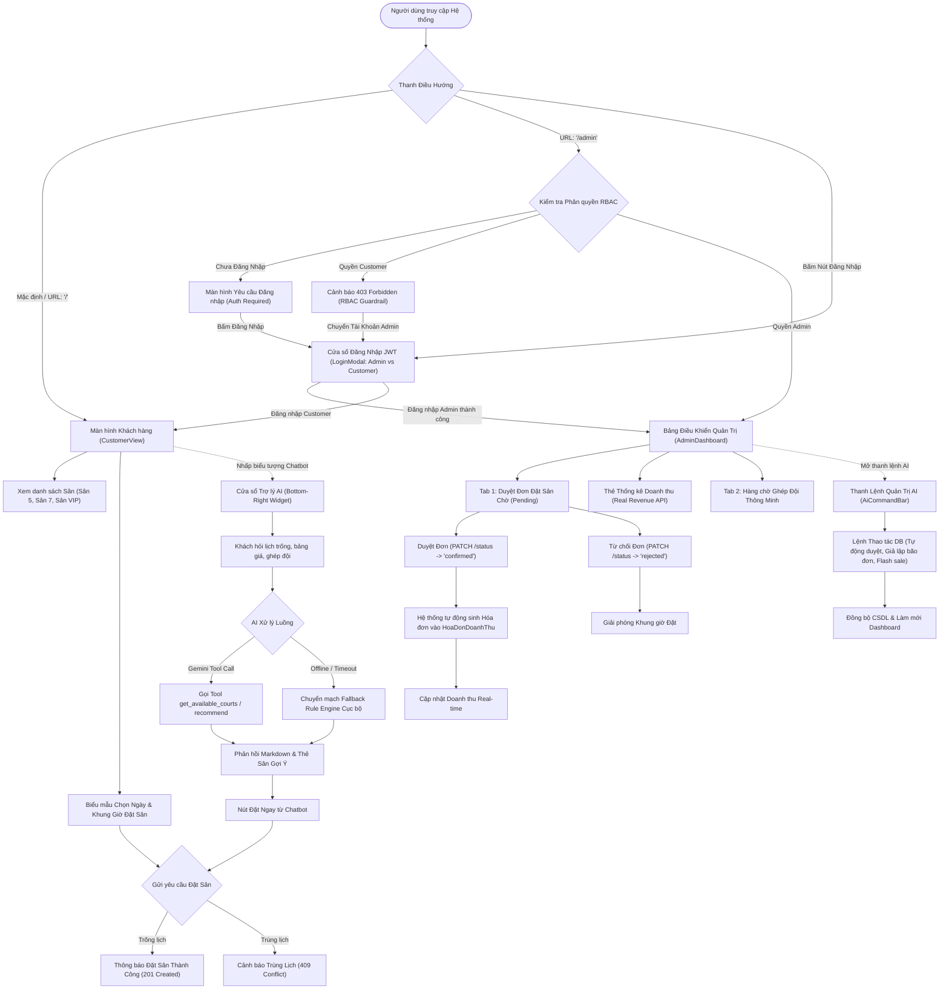
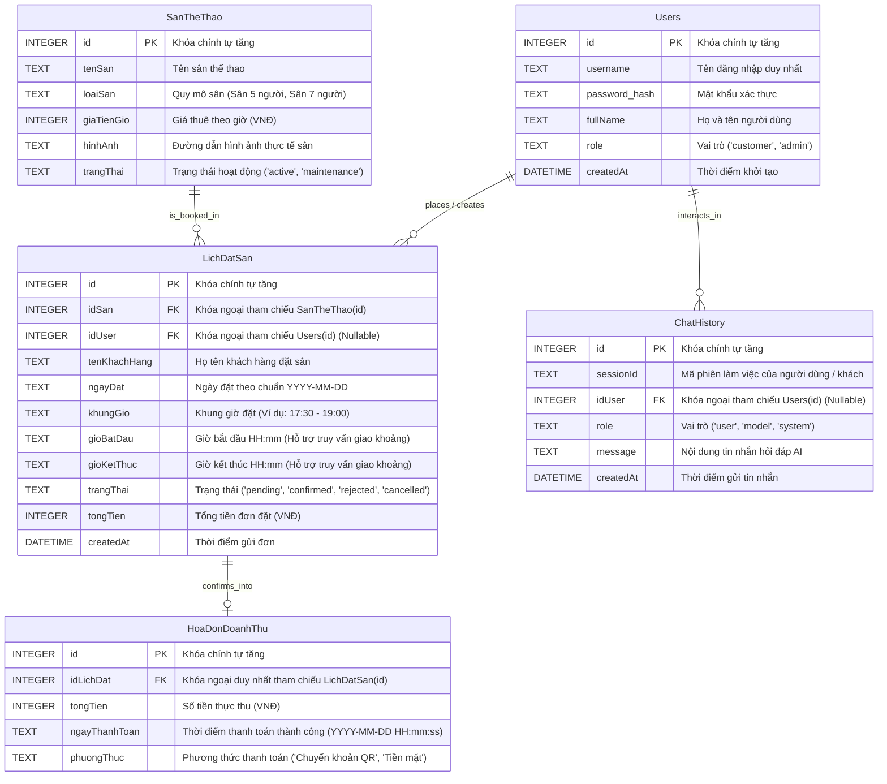

# SCREEN FLOW & TÀI LIỆU THIẾT KẾ CƠ SỞ DỮ LIỆU
## DỰ ÁN: HỆ THỐNG QUẢN LÝ SÂN THỂ THAO TÍCH HỢP AI (SPORTAI)

> **Học phần:** Phát triển Phần mềm với GenAI (GenAI Software Development)  
> **Sinh viên thực hiện:** Hoàng Hữu Đạt (DTC245200049)  
> **Thời gian thực hiện:** Kế hoạch thực hiện chuẩn SDLC  
> **Kiến trúc hệ thống:** Single Page Application (React + Vite + TypeScript) • Backend RESTful API (Node.js + Express) • CSDL Chuẩn hóa SQLite • Trợ lý AI (Gemini 1.5/2.0 Flash Function Calling & NLU Fallback Engine).

---

## 1. SCREEN FLOW: PHÂN LUỒNG MÀN HÌNH CỦA ỨNG DỤNG

Hệ thống SportAI bao gồm 2 phân hệ người dùng chính: **Phân hệ Khách hàng (Customer View)** và **Phân hệ Quản trị viên (Admin Dashboard)**, được liên kết liền mạch qua thanh điều hướng Top Navigation Bar và Widget Chatbot AI tương tác thời gian thực.

### 1.1. Sơ đồ Luồng Màn hình Tổng thể (Overall Screen Flow)



---

### 1.2. Đặc tả Chi tiết Các Màn hình & Tương tác Nghiệp vụ

| STT | Tên Màn hình | Route URL | Tác nhân (Actor) | Chức năng & Thành phần UI Chính | Hành động Kích hoạt API |
| :---: | :--- | :--- | :--- | :--- | :--- |
| **SCR-01** | **Giao diện Khách hàng** | `/` | Khách vãng lai, Người chơi | • Banner giới thiệu công nghệ SportAI.<br>• Bộ lọc ngày đặt sân (Date Picker).<br>• Lưới danh sách 3 sân bóng (`Sân Trung Tâm A1`, `Sân Tập B2`, `Sân VIP C3`) hiển thị giá theo chuẩn `#,##0 VNĐ/h`.<br>• Bộ chọn khung giờ vàng (17:00, 18:00, 19:00, 20:30) và ô nhập tên khách.<br>• Hộp thông báo màu xanh (Thành công) hoặc màu đỏ (Trùng lịch 409). | `GET /api/courts`<br>`POST /api/bookings`<br>`GET /api/check-availability` |
| **SCR-02** | **Widget Chatbot AI 24/7** | Nổi góc phải màn hình | Khách vãng lai, Người chơi | • Nút tròn nổi mở nhanh cửa sổ trò chuyện.<br>• Lịch sử chat đa lượt (Multi-turn chat).<br>• Khung nhập câu hỏi tự nhiên.<br>• Thẻ đề xuất sân thông minh (Action Card) có ảnh, tag tiện ích và nút bấm giữ chỗ trực tiếp. | `POST /api/chat`<br>`POST /api/bookings` |
| **SCR-03** | **Bảng Điều khiển Quản trị** | `/admin` | Chủ sân, Quản lý (Admin) | • 3 Thẻ thống kê KPI (Tổng doanh thu thật từ CSDL, Số đơn đặt, Tỷ lệ lấp đầy).<br>• Tab Duyệt Đơn: Danh sách lịch đặt sân kèm nút "Duyệt (Chốt)" và "Từ chối".<br>• Tab Ghép Đội: Hàng chờ ghép team theo Elo và số lượng người.<br>• Tự động quét và làm mới số liệu mỗi 4 giây. | `POST /api/auth/login`<br>`GET /api/bookings`<br>`GET /api/revenue`<br>`PATCH /api/bookings/:id/status` |
| **SCR-04** | **Thanh Lệnh Quản trị AI** | Modal góc Admin | Quản trị viên (Admin) | • Switch chuyển đổi chế độ "Tư vấn" / "Thao tác DB".<br>• Cửa sổ dòng lệnh Terminal AI nhận diện intent NLU.<br>• Tự động kích hoạt Auto-Simulation sinh đơn đặt ngẫu nhiên hoặc kích hoạt chiến dịch giảm giá Flash Sale toàn hệ thống. | `POST /api/admin/ai-execute` |

---

## 2. CƠ SỞ DỮ LIỆU (DATABASE SPECIFICATION)

Cơ sở dữ liệu của hệ thống SportAI được thiết kế và hiện thực trên nền tảng **SQLite 3** (`backend/database.db`), tuân thủ chuẩn hóa dạng 3NF (Third Normal Form), đảm bảo toàn vẹn tham chiếu thông qua khóa ngoại (`FOREIGN KEY`) và chuẩn hóa kiểu tiền tệ thành số nguyên `INTEGER` (VNĐ) nhằm triệt tiêu hoàn toàn sai số dấu phẩy động trong kế toán.

### 2.1. Sơ đồ Thực thể - Mối quan hệ (Entity Relationship Diagram - ERD)



---

### 2.2. Từ điển Dữ liệu Chi tiết (Data Dictionary - 5 Bảng Chuẩn Hóa)

#### Bảng 1: `Users` (Người dùng & Phân quyền RBAC)
Lưu trữ thông tin tài khoản người dùng, phục vụ đăng nhập JWT và phân quyền 2 lớp (Customer vs Admin).

| Tên Cột (Column) | Kiểu Dữ liệu | Khóa | Cho phép NULL | Giá trị Mặc định | Mô tả & Ràng buộc Nghiệp vụ |
| :--- | :--- | :---: | :---: | :---: | :--- |
| `id` | `INTEGER` | **PK** | Không | `AUTOINCREMENT` | Mã định danh duy nhất của người dùng. |
| `username` | `TEXT` | **UK** | Không | Không | Tên tài khoản đăng nhập (Duy nhất toàn hệ thống). |
| `password_hash` | `TEXT` | Không | Không | Không | Mật khẩu xác thực tài khoản. |
| `fullName` | `TEXT` | Không | Không | Không | Họ và tên hiển thị của người dùng. |
| `role` | `TEXT` | Không | Không | `'customer'` | Vai trò người dùng trong hệ thống: Nhận giá trị `'customer'` hoặc `'admin'`. Phục vụ rào chắn an toàn RBAC. |
| `createdAt` | `DATETIME` | Không | Không | `CURRENT_TIMESTAMP` | Thời điểm tài khoản được khởi tạo trong hệ thống. |

---

#### Bảng 2: `SanTheThao` (Danh mục Sân Thể Thao)
Lưu trữ cấu hình kỹ thuật, quy mô và bảng giá theo giờ của các sân trong cụm thể thao.

| Tên Cột (Column) | Kiểu Dữ liệu | Khóa | Cho phép NULL | Giá trị Mặc định | Mô tả & Ràng buộc Nghiệp vụ |
| :--- | :--- | :---: | :---: | :---: | :--- |
| `id` | `INTEGER` | **PK** | Không | `AUTOINCREMENT` | Mã số định danh sân thể thao. |
| `tenSan` | `TEXT` | Không | Không | Không | Tên gọi của sân (Ví dụ: `Sân Trung Tâm A1`, `Sân Tập B2`, `Sân VIP C3`). |
| `loaiSan` | `TEXT` | Không | Không | Không | Phân loại quy mô sân: `'Sân 5 người'`, `'Sân 7 người'`. |
| `giaTienGio` | `INTEGER` | Không | Không | Không | Đơn giá thuê sân 1 giờ tính bằng đơn vị tiền tệ VNĐ (Ví dụ: `250000`, `150000`, `300000`). Ràng buộc: `giaTienGio > 0`. |
| `hinhAnh` | `TEXT` | Không | Có | `NULL` | Đường dẫn URL hình ảnh chất lượng cao mô tả mặt sân. |
| `trangThai` | `TEXT` | Không | Không | `'active'` | Trạng thái sân: `'active'` (Đang hoạt động tốt), `'maintenance'` (Đang bảo trì cỏ/đèn). |

---

#### Bảng 3: `LichDatSan` (Quản lý Lịch Đặt Chỗ)
Ghi nhận các yêu cầu giữ chỗ, phục vụ thuật toán kiểm tra chống trùng lịch 2 tầng (Double-Check Locking).

| Tên Cột (Column) | Kiểu Dữ liệu | Khóa | Cho phép NULL | Giá trị Mặc định | Mô tả & Ràng buộc Nghiệp vụ |
| :--- | :--- | :---: | :---: | :---: | :--- |
| `id` | `INTEGER` | **PK** | Không | `AUTOINCREMENT` | Mã định danh đơn đặt sân. |
| `idSan` | `INTEGER` | **FK** | Không | Không | Tham chiếu đến `SanTheThao(id)`. |
| `idUser` | `INTEGER` | **FK** | Có | `NULL` | Tham chiếu đến `Users(id)`. Cho phép NULL đối với khách vãng lai đặt ngoài hoặc đặt qua chatbot AI. |
| `tenKhachHang` | `TEXT` | Không | Không | Không | Tên người đặt hoặc tên đội bóng (Ví dụ: `Nguyễn Văn A`, `FC Anh Em`). |
| `ngayDat` | `TEXT` | Không | Không | Không | Ngày sử dụng sân theo định dạng ISO chuẩn `YYYY-MM-DD`. |
| `khungGio` | `TEXT` | Không | Không | Không | Khung giờ sử dụng dạng nhãn (Ví dụ: `'17:30 - 19:00'`, `'19:00 - 20:30'`). |
| `gioBatDau` | `TEXT` | Không | Không | Không | Giờ bắt đầu (`HH:mm`, ví dụ: `'17:30'`), hỗ trợ thuật toán giao thoa khoảng thời gian. |
| `gioKetThuc` | `TEXT` | Không | Không | Không | Giờ kết thúc (`HH:mm`, ví dụ: `'19:00'`), hỗ trợ thuật toán giao thoa khoảng thời gian. |
| `trangThai` | `TEXT` | Không | Không | `'pending'` | Trạng thái đơn đặt: `'pending'` (Chờ duyệt/giữ chỗ), `'confirmed'` (Đã duyệt thành công), `'rejected'` (Từ chối), `'cancelled'` (Khách hủy). |
| `tongTien` | `INTEGER` | Không | Không | Không | Tổng giá trị đơn đặt sân tính bằng VNĐ. Ràng buộc: `tongTien >= 0`. |
| `createdAt` | `DATETIME` | Không | Không | `CURRENT_TIMESTAMP` | Thời điểm gửi yêu cầu đặt chỗ. |

---

#### Bảng 4: `HoaDonDoanhThu` (Hóa đơn & Báo cáo Doanh thu)
Ghi nhận số liệu tài chính phục vụ chức năng thống kê và tool AI `generate_revenue_report`.

| Tên Cột (Column) | Kiểu Dữ liệu | Khóa | Cho phép NULL | Giá trị Mặc định | Mô tả & Ràng buộc Nghiệp vụ |
| :--- | :--- | :---: | :---: | :---: | :--- |
| `id` | `INTEGER` | **PK** | Không | `AUTOINCREMENT` | Mã hóa đơn thanh toán. |
| `idLichDat` | `INTEGER` | **FK, UK** | Không | Không | Khóa ngoại duy nhất tham chiếu đến `LichDatSan(id)`. Đảm bảo quan hệ 1:1 giữa đơn chốt cọc và hóa đơn. |
| `tongTien` | `INTEGER` | Không | Không | Không | Số tiền thực thu ghi nhận doanh thu (VNĐ). Khớp 1:1 với `LichDatSan.tongTien`. |
| `ngayThanhToan` | `TEXT` | Không | Không | Không | Thời điểm xác nhận thanh toán theo chuẩn `YYYY-MM-DD HH:mm:ss`. |
| `phuongThuc` | `TEXT` | Không | Không | `'Chuyển khoản QR'` | Phương thức thanh toán: `'Chuyển khoản QR'`, `'Tiền mặt'`, `'Ví điện tử'`. |

---

#### Bảng 5: `ChatHistory` (Nhật ký Hội thoại AI Chatbot)
Lưu trữ toàn bộ phiên tương tác hỏi đáp đa lượt (Multi-turn conversation), giải quyết triệt để vấn đề Stateless của Chatbot và cung cấp dữ liệu kiểm toán cho Admin.

| Tên Cột (Column) | Kiểu Dữ liệu | Khóa | Cho phép NULL | Giá trị Mặc định | Mô tả & Ràng buộc Nghiệp vụ |
| :--- | :--- | :---: | :---: | :---: | :--- |
| `id` | `INTEGER` | **PK** | Không | `AUTOINCREMENT` | Mã số định danh bản ghi chat. |
| `sessionId` | `TEXT` | Không | Không | Không | Mã định danh phiên làm việc (Session ID) gắn liền với trình duyệt người dùng. |
| `idUser` | `INTEGER` | **FK** | Có | `NULL` | Tham chiếu đến `Users(id)`. NULL nếu là khách vãng lai chưa đăng nhập. |
| `role` | `TEXT` | Không | Không | Không | Vai trò người gửi: `'user'` (Khách đặt câu hỏi), `'model'` (Phản hồi của Gemini AI), `'system'` (Chỉ thị hệ thống). |
| `message` | `TEXT` | Không | Không | Không | Nội dung trao đổi hội thoại. |
| `createdAt` | `DATETIME` | Không | Không | `CURRENT_TIMESTAMP` | Thời điểm ghi nhận tin nhắn. |

---

### 2.3. Các Ràng buộc Toàn vẹn trong CSDL (Integrity Constraints)

1. **Ràng buộc Toàn vẹn Thực thể (Entity Integrity):**
   - Mọi bảng đều có trường `id` kiểu số nguyên tự tăng (`INTEGER PRIMARY KEY AUTOINCREMENT`), đảm bảo mỗi bản ghi là duy nhất.
2. **Ràng buộc Toàn vẹn Tham chiếu (Referential Integrity):**
   - Khóa ngoại `LichDatSan.idSan` tham chiếu hợp lệ tới `SanTheThao(id)`.
   - Khóa ngoại `LichDatSan.idUser` tham chiếu hợp lệ tới `Users(id)`.
   - Khóa ngoại `HoaDonDoanhThu.idLichDat` tham chiếu hợp lệ tới `LichDatSan(id)`.
   - Khóa ngoại `ChatHistory.idUser` tham chiếu hợp lệ tới `Users(id)`.
3. **Ràng buộc Miền giá trị (Domain Integrity):**
   - Trường `role` trong bảng `Users` chỉ chấp nhận các giá trị: `'customer'`, `'admin'`.
   - Trường `trangThai` trong bảng `LichDatSan` chỉ chấp nhận các giá trị: `'pending'`, `'confirmed'`, `'rejected'`, `'cancelled'`.
   - Các trường tiền tệ (`SanTheThao.giaTienGio`, `LichDatSan.tongTien`, `HoaDonDoanhThu.tongTien`) bắt buộc là số nguyên dương >= 0.
4. **Ràng buộc Nghiệp vụ Chống Trùng Lịch & Concurrency Guard (2 Tầng):**
   - *Tầng 1 (Code Backend):* Kiểm tra trước bằng câu truy vấn `SELECT ... LIMIT 1` với điều kiện `idSan`, `ngayDat`, `khungGio` và `trangThai IN ('pending', 'confirmed')`.
   - *Tầng 2 (CSDL SQLite - Khóa cứng chống Race Condition):*
     ```sql
     CREATE UNIQUE INDEX IF NOT EXISTS idx_unique_active_booking 
     ON LichDatSan(idSan, ngayDat, khungGio) 
     WHERE trangThai NOT IN ('rejected', 'cancelled');
     ```
     Nếu xảy ra 2 yêu cầu đặt đồng thời vào cùng một tích tắc, SQLite sẽ chặn đứng bản ghi thứ hai với mã lỗi `SQLITE_CONSTRAINT_UNIQUE`, Backend bắt lỗi và trả về HTTP `409 Conflict` an toàn.
5. **Ràng buộc Truy vấn Giao Khoảng Thời gian (Interval Overlap):**
   - Hỗ trợ công cụ AI Function Calling `get_available_courts` và `recommend_booking_options` tìm kiếm sân trống chính xác theo điều kiện:
     `gioBatDau < endTime AND gioKetThuc > startTime`.
6. **Ràng buộc Đồng bộ Tự động Hóa đơn Doanh thu:**
   - Khi Admin chuyển trạng thái `LichDatSan.trangThai` từ `'pending'` sang `'confirmed'`, Backend tự động thực thi lệnh `INSERT INTO HoaDonDoanhThu` với số tiền và thời gian tương ứng. Doanh thu hợp lệ chỉ tính trên các đơn `confirmed` có hóa đơn thực tế.