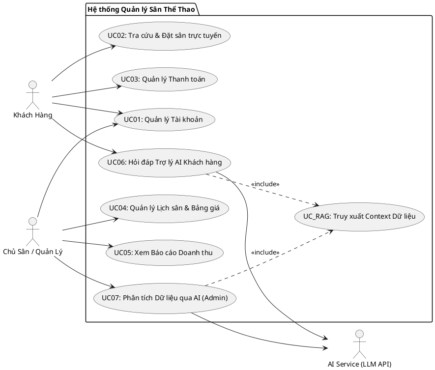
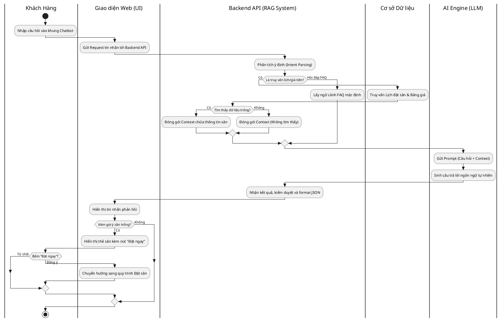
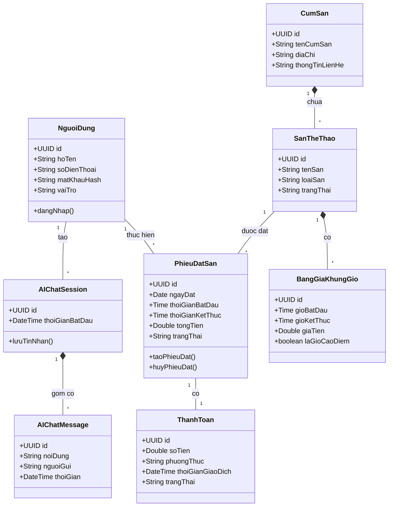

# MỤC LỤC
1. [CHƯƠNG 1: KHẢO SÁT VÀ THU THẬP YÊU CẦU NGHIỆP VỤ](#chuong-1)
   1.1. [Mục tiêu và Phạm vi Khảo sát](#11-muc-tieu)
   1.2. [Nội dung Thu thập từ Hiện trạng](#12-noi-dung)
      1.2.1. [Quy trình Quản lý Lịch & Khách hàng hiện tại](#121-quy-trinh)
      1.2.2. [Khảo sát Mô hình Giá](#122-khao-sat-gia)
      1.2.3. [Khảo sát Khách hàng / Người chơi](#123-khao-sat-khach)
      1.2.4. [Khảo sát Hạ tầng Kỹ thuật tại Cụm sân](#124-khao-sat-ha-tang)
2. [CHƯƠNG 2: PHÂN TÍCH YÊU CẦU NGHIỆP VỤ (REQUIREMENT ANALYSIS)](#chuong-2)
   2.1. [Yêu cầu Kinh doanh (Business Requirements)](#21-yeu-cau-kinh-doanh)
   2.2. [Ràng buộc Kỹ thuật (System Constraints)](#22-rang-buoc)
3. [CHƯƠNG 3: ĐẶC TẢ YÊU CẦU PHẦN MỀM VÀ THIẾT KẾ HỆ THỐNG UML](#chuong-3)
   3.1. [Biểu đồ Use Case Tổng quát (General Use Case)](#31-use-case)
   3.2. [Sơ đồ Hoạt động (Activity Diagram)](#32-activity)
   3.3. [Biểu đồ Lớp Phân tích (Class Diagram)](#33-class)

---

# CHƯƠNG 1: KHẢO SÁT VÀ THU THẬP YÊU CẦU NGHIỆP VỤ

## 1.1. Mục tiêu và Phạm vi Khảo sát
Tài liệu này tập trung vào việc thu thập hiện trạng vận hành tại các cụm sân thể thao. Trọng tâm của hệ thống giải pháp sau này là **Số hóa quy trình quản lý lịch sân, doanh thu** và **Tích hợp Trợ lý ảo AI (Chatbot)** để hỗ trợ hỏi đáp, đặt sân và phân tích dữ liệu cơ bản. 
*(Lưu ý: Phạm vi dự án KHÔNG bao gồm tích hợp phần cứng tự động hóa như IoT ngắt điện hay Camera nhận diện AI).*

## 1.2. Nội dung Thu thập từ Hiện trạng

### 1.2.1. Quy trình Quản lý Lịch & Khách hàng hiện tại
- **Phương thức ghi nhận lịch:** Đang dùng sổ tay ghi chép, file Excel rời rạc hoặc Zalo.
- **Chính sách đặt cọc:** Yêu cầu chuyển khoản 30% – 50%. Khách phải chụp biên lai gửi qua Zalo, nhân viên mất thời gian check app ngân hàng để đối soát.
- **Điểm nghẽn:** 
  - **Trùng lịch (Overbooking):** 2 nhân viên cùng nhận lịch 1 sân qua 2 kênh khác nhau.
  - **Độ trễ cao:** Khách hàng phải đợi 5-15 phút để nhân viên kiểm tra lịch trống và đối soát tiền cọc.

### 1.2.2. Khảo sát Mô hình Giá
- Đang áp dụng giá cố định (Giờ thường/Giờ vàng) rất cứng nhắc. Tỷ lệ lấp đầy giờ thấp điểm chỉ đạt 15-20%.
- Chủ sân mong muốn hệ thống có thể tự động phân tích và gợi ý giảm giá giờ trống để thu hút sinh viên.

### 1.2.3. Khảo sát Khách hàng / Người chơi
- Khách hàng phàn nàn vì mất quá nhiều thời gian chờ đợi phản hồi tin nhắn Zalo/Fanpage từ chủ sân chỉ để hỏi thông tin cơ bản: *"Chiều nay 5h còn sân không?"*.

### 1.2.4. Khảo sát Hạ tầng Kỹ thuật tại Cụm sân
- **Hiện trạng:** Các sân có sẵn Wi-Fi và nhân viên có sử dụng máy tính/điện thoại thông minh.
- **Kết luận:** Chủ sân mong muốn một hệ thống nền tảng Web App thuần túy, có thể truy cập mọi lúc mọi nơi. Không yêu cầu cải tạo hạ tầng điện hay lắp đặt thiết bị ngoại vi đắt tiền.

---

# CHƯƠNG 2: PHÂN TÍCH YÊU CẦU NGHIỆP VỤ (REQUIREMENT ANALYSIS)

## 2.1. Yêu cầu Kinh doanh (Business Requirements)
- **BR-01:** Triệt tiêu hoàn toàn rủi ro trùng lịch (Overbooking) bằng dữ liệu tập trung.
- **BR-02:** Tự động hóa quy trình tra cứu lịch trống và thanh toán cọc trực tuyến qua cổng thanh toán/QR Code.
- **BR-03:** Ứng dụng AI Chatbot để trả lời tin nhắn khách hàng 24/7, giảm tải 80% thời gian trực chat của nhân viên.

## 2.2. Ràng buộc Kỹ thuật (System Constraints)
- **CON-01 (Nền tảng):** Hệ thống chạy trên nền tảng Web, thiết kế Responsive hỗ trợ hiển thị tốt trên Mobile (Smartphone, Tablet).
- **CON-02 (AI Integration):** Module AI phải giới hạn trong phạm vi tư vấn bằng văn bản (RAG Chatbot), truy vấn đúng dữ liệu sân đang trống từ CSDL, tuyệt đối không tự bịa thông tin (No Hallucination).

---

# CHƯƠNG 3: ĐẶC TẢ YÊU CẦU PHẦN MỀM VÀ THIẾT KẾ HỆ THỐNG UML

## 3.1. Biểu đồ Use Case Tổng quát (General Use Case Diagram)
Biểu đồ này mô tả các ca sử dụng tổng quan. Tác nhân (Actor) tương tác trực tiếp với hệ thống. Trợ lý AI có nhiệm vụ hỗ trợ tính năng tra cứu thông qua dữ liệu RAG.

## 3.2. Sơ đồ Hoạt động (Activity Diagram)
Sơ đồ hoạt động dưới đây mô tả luồng Khách hàng tương tác với AI Chatbot. Được thiết kế với **Phân làn bơi (Swimlanes)** rõ ràng để tách biệt tầng Giao diện (Front-end), Xử lý nghiệp vụ (Back-end/RAG) và Dịch vụ ngoài (AI Engine).

## 3.3. Biểu đồ Lớp Phân tích (Class Diagram)
Hệ thống thực thể đã được phân tích theo đúng tiêu chuẩn OOP (Hướng đối tượng), mô tả đầy đủ các quan hệ như kết tập (Aggregation) và liên kết (Association) kèm cấp số bội.

## 3.4. Đặc tả chi tiết các Use Case tương tác AI trọng tâm

### 3.4.1. Đặc tả Use Case UC06: Hỏi đáp Trợ lý AI Khách hàng
- **Mã Use Case:** UC06
- **Mô tả:** Khách hàng nhắn tin với Chatbot trên Web để tìm sân trống, hỏi giá mà không cần nhân viên hỗ trợ.
- **Tác nhân:** Khách hàng, AI Service, Hệ thống CSDL.
- **Dòng sự kiện chính:**
  1. Khách hàng mở khung Chatbot và nhập: *"Tối nay 19h sân 5 còn trống không?"*.
  2. Giao diện Web gửi câu hỏi tới Backend API.
  3. Backend phân tích ý định (Intent: Tra cứu lịch trống) và truy vấn CSDL (Lịch đặt sân, Bảng giá).
  4. Backend đóng gói thông tin sân trống vào Prompt và gửi tới AI Engine.
  5. AI Engine sinh câu trả lời tự nhiên.
  6. Backend gửi câu trả lời về UI. Khách hàng nhận được kết quả kèm nút **"Đặt ngay"**.
- **Dòng sự kiện ngoại lệ:**
  - *Lỗi kết nối AI:* Hệ thống hiển thị danh sách sân trống dạng bảng chuẩn (Grid) thay vì câu chữ tự nhiên.
  - *Không có sân trống:* AI tự động gợi ý khung giờ lân cận hoặc sân ở cụm gần nhất.

### 3.4.2. Đặc tả Use Case UC07: Phân tích Dữ liệu qua AI (Admin)
- **Mã Use Case:** UC07
- **Mô tả:** Chủ sân gõ câu hỏi bằng ngôn ngữ tự nhiên để xem báo cáo doanh thu, đánh giá khách hàng.
- **Tác nhân:** Admin, AI Service, CSDL.
- **Dòng sự kiện chính:**
  1. Admin nhập lệnh: *"Doanh thu tuần này so với tuần trước thế nào?"*.
  2. Backend truy vấn bảng HoaDonDoanhThu, tính toán số liệu và gửi Context cho AI.
  3. AI tóm tắt thành văn bản trực quan. Hệ thống cũng có thể sinh biểu đồ cột/tròn đi kèm nếu cần thiết.

---

# CHƯƠNG 4: BẢNG DỮ LIỆU CONTEXT VÀ THIẾT KẾ GIAO DIỆN

## 4.1. Bảng mô tả Đơn vị Thực thể cơ bản (RAG Context)
Để AI trả lời chính xác, các bảng sau là đầu vào dữ liệu (Context) bắt buộc cho prompt:
- **SanTheThao:** Giúp AI biết thông tin kỹ thuật sân (5 người, 7 người) và trạng thái.
- **LichDatSan:** Cung cấp dữ liệu để AI kiểm tra khung giờ nào còn trống (Real-time).
- **BangGiaKhungGio:** Giúp AI tư vấn giá tiền và gợi ý khung giờ rẻ hơn (Off-peak).
- **PhieuDatSan / ThanhToan:** Cung cấp thông tin để AI theo dõi đối soát doanh thu khi Admin hỏi.

## 4.2. Thiết kế Giao diện Demo Cửa sổ Hỏi đáp AI

### 4.2.1. Giao diện Chatbot Khách hàng (User Web Interface)
- **Vị trí:** Widget hình tròn cố định ở góc dưới bên phải màn hình (Bottom-Right Floating).
- **Khung Chat (Chat Body):**
  - Tin nhắn chào mừng tự động chứa các câu hỏi gợi ý nhanh (Quick Suggestions) như: *"Sân chiều nay còn trống không?", "Tư vấn thuê dụng cụ"*.
  - Bong bóng chat màu xanh (căn phải) cho Khách hàng, màu xám nhạt (căn trái) cho AI.
- **Thao tác tích hợp (Contextual Actions):** Nếu AI trả lời có sân trống, giao diện sẽ hiển thị kèm một "Thẻ thông tin sân" (Court Card) có nút bấm **"Đặt ngay"** chuyển thẳng sang trang thanh toán.

### 4.2.2. Giao diện Trợ lý Phân tích AI phía Chủ sân (Admin Dashboard)
- **Vị trí:** Thanh tìm kiếm AI thông minh (AI Command Bar) đặt tại vị trí trung tâm phía trên cùng trang Admin Dashboard.
- **Cửa sổ Kết quả (AI Insight Modal):**
  - **Khối Tóm tắt (Summary):** Câu trả lời dạng văn bản tích hợp số liệu kinh doanh.
  - **Khối Gợi ý đề xuất (Actionable Insights):** AI gợi ý như *"Giảm 20% giá sân 7 người vào khung giờ 9h-11h Thứ Bảy"*. Nút bấm **"Áp dụng khuyến mãi"** nằm ngay dưới để chủ sân kích hoạt lập tức.
