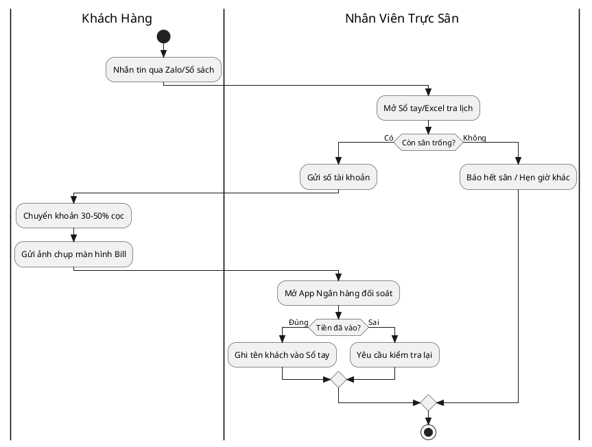
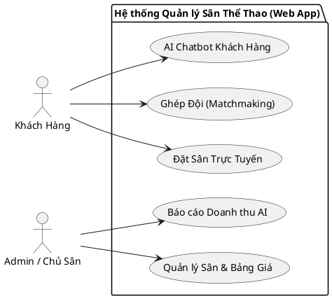
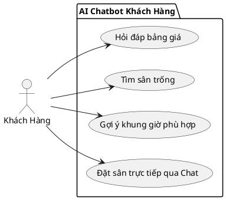
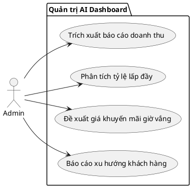
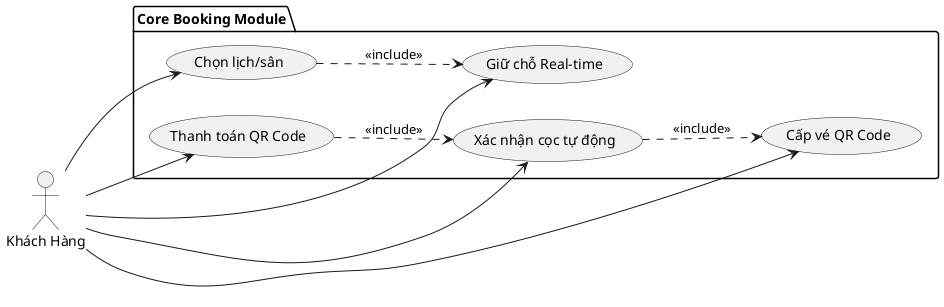
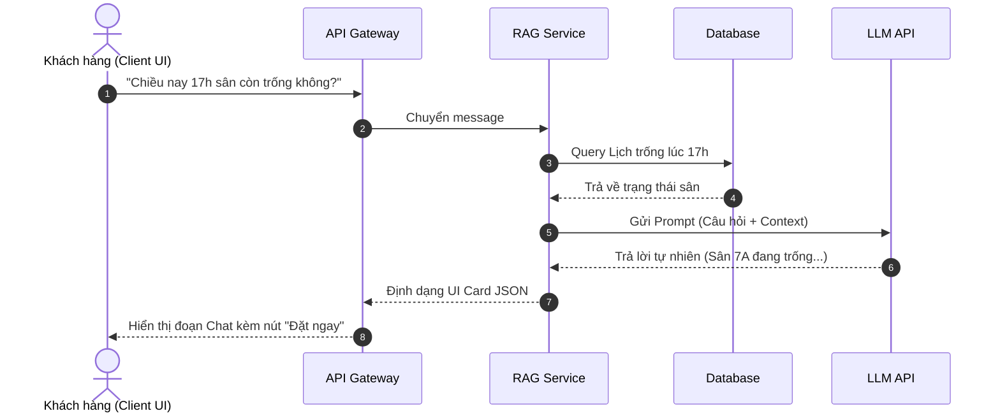
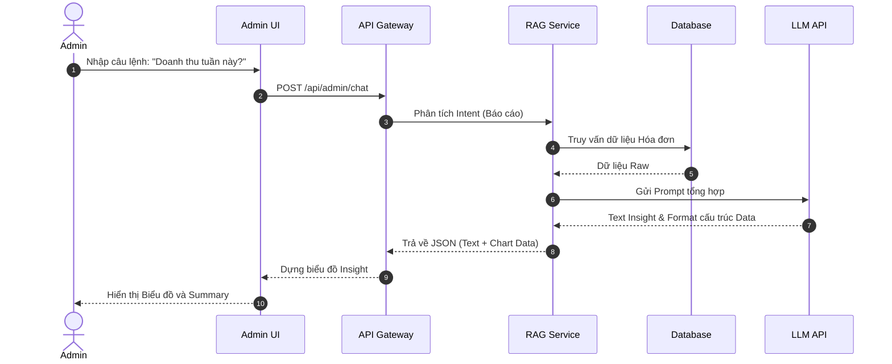
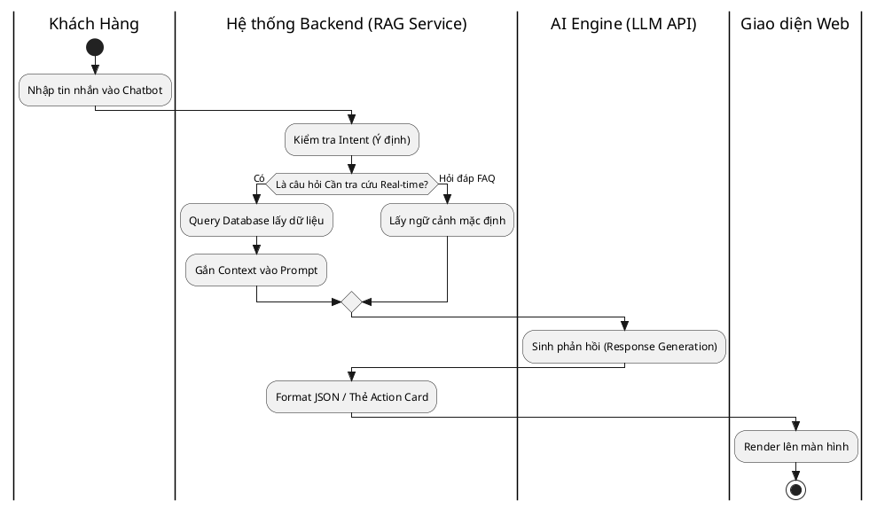
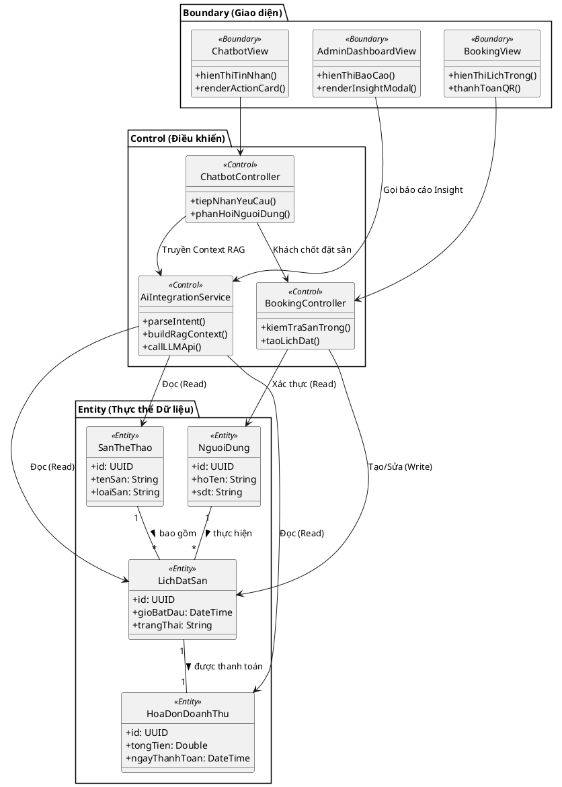
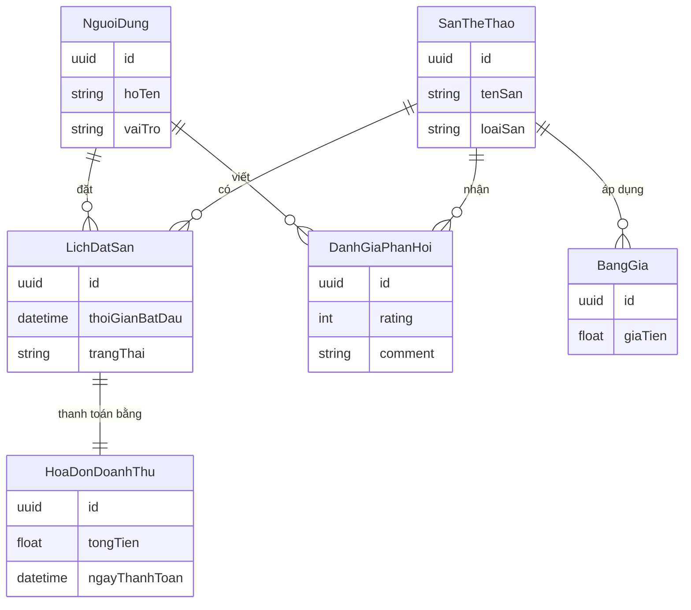

# MỤC LỤC
1. [CHƯƠNG 1: KHẢO SÁT VÀ THU THẬP YÊU CẦU NGHIỆP VỤ](#chuong-1)
2. [CHƯƠNG 2: PHÂN TÍCH YÊU CẦU NGHIỆP VỤ (REQUIREMENT ANALYSIS)](#chuong-2)
3. [CHƯƠNG 3: ĐẶC TẢ YÊU CẦU PHẦN MỀM VÀ KIẾN TRÚC AI](#chuong-3)
4. [CHƯƠNG 4: CƠ SỞ DỮ LIỆU CONTEXT VÀ THIẾT KẾ GIAO DIỆN AI](#chuong-4)

---

# CHƯƠNG 1: KHẢO SÁT VÀ THU THẬP YÊU CẦU NGHIỆP VỤ

## 1.1. Phương pháp khảo sát tiêu chuẩn
Dự án được định hướng thuần túy là phần mềm Web App Responsive và ứng dụng AI Chatbot (RAG). Hệ thống tuyệt đối không áp dụng khảo sát hạ tầng tủ điện hay phần cứng.

| STT | Phương pháp Khảo sát | Đối tượng Áp dụng | Mục tiêu Khảo sát |
|---|---|---|---|
| 1 | Phỏng vấn sâu (1-on-1) | Chủ sân, Quản lý | Lấy thông tin về nỗi đau quản lý, doanh thu và định giá. |
| 2 | Khảo sát diện rộng | Khách hàng | Hiểu thói quen đặt sân, thanh toán và nhu cầu ghép đội. |
| 3 | Quan sát thực địa (Job Shadowing) | Nhân viên trực ca | Đánh giá quy trình ghi chép thủ công, đối soát tiền. |
| 4 | Phân tích tài liệu & sản phẩm | Sổ tay, Excel | Phân tích cấu trúc dữ liệu lưu trữ hiện tại của sân. |

## 1.2. Khảo sát nhu cầu ghép đội & kho hàng
- **Nhu cầu ghép đội (Matchmaking):** Khảo sát người chơi lẻ cho thấy tỷ lệ hủy trận do "thiếu cạ" lên tới **30%**. Có đến **85%** người chơi có nhu cầu tìm đối thủ hoặc đồng đội ngang trình độ (Elo) trong bán kính dưới 5km.
- **Khảo sát dịch vụ phụ trợ:** Việc bán nước uống, cho thuê dụng cụ (vợt, giày, áo bíp) mang lại doanh thu phụ nhưng khó kiểm kê. Hiện tại nhân viên thu tiền mặt riêng lẻ, khiến việc quản lý tồn kho và gộp hóa đơn cuối ngày bị sai lệch.

## 1.3. Mô hình định giá linh hoạt (Dynamic Pricing)
Chủ sân phàn nàn về sự thiếu hiệu quả của giá cố định. Họ có nhu cầu thiết lập cơ chế định giá linh hoạt:
- Tự thiết lập **Giá sàn (Floor Price)** và **Giá trần (Ceiling Price)**.
- Hệ thống tự động thay đổi giá theo các biến số: tỷ lệ lấp đầy thời gian thực (real-time occupancy), tình hình thời tiết, các ngày Lễ/Tết và khoảng thời gian khách đặt trước.

---

# CHƯƠNG 2: PHÂN TÍCH YÊU CẦU NGHIỆP VỤ (REQUIREMENT ANALYSIS)

## 2.1. Phân tích quy trình hiện tại (As-Is Process Analysis)
Hiện tại, 3 luồng vận hành cốt lõi (As-Is) đang bộc lộ điểm nghẽn nghiêm trọng:
1. **Đặt sân & Thu cọc thủ công:** Tiếp nhận lịch qua Zalo/Sổ tay. Khách chuyển khoản xong phải gửi ảnh chụp bill, nhân viên mất 5-15 phút để check App ngân hàng. Rủi ro **Overbooking** (trùng lịch) rất cao.
2. **Khai thác giá cố định:** Khung giờ cao điểm quá tải, trong khi khung giờ thấp điểm (sáng/trưa) bị bỏ trống tới 80-85%.
3. **Quản lý dịch vụ phụ trợ:** Thu tiền mặt thủ công dễ dẫn đến gian lận và không lưu log lịch sử bán hàng.

**Sơ đồ 1: Luồng quy trình hiện tại (As-Is Process Flowchart)**

## 2.2. Bảng Phân tích Nguyên nhân Gốc rễ (Root Cause Analysis - RCA)

| Pain Points (Nỗi đau) | Root Causes (Nguyên nhân gốc rễ) | Business Impacts (Tác động kinh doanh) | Requirement Goals (Yêu cầu bài toán) |
|---|---|---|---|
| Trùng lịch đặt sân (Overbooking) | Quản lý thủ công, phân tán trên Zalo và Sổ tay bởi nhiều nhân viên. | Giảm uy tín thương hiệu, khách hàng tức giận. | Số hóa, tập trung hóa dữ liệu đặt sân real-time. |
| Thất thoát doanh thu dịch vụ | Nhân viên tự thu tiền mặt dịch vụ phụ trợ, không lưu log hệ thống. | Mất 15-20% doanh thu thực tế hàng tháng. | Tích hợp giỏ hàng thanh toán chung với tiền sân. |
| Bỏ trống sân giờ thấp điểm | Bảng giá cứng nhắc, không có kênh tiếp cận đối tượng sinh viên. | Lãng phí tài nguyên sân bãi, ROI thấp. | Hệ thống AI phân tích và gợi ý khuyến mãi linh hoạt. |

## 2.3. Hoàn thiện Hệ thống Yêu cầu (Requirements Classification)

**1. Yêu cầu kinh doanh (Business Requirements - BR):**
- BR-01: Triệt tiêu rủi ro trùng lịch (Overbooking) trên toàn hệ thống.
- BR-02: Giảm tỷ lệ thất thoát doanh thu tiền giờ và dịch vụ xuống dưới 1%.
- BR-03: Tăng tỷ lệ lấp đầy sân vào khung giờ thấp điểm thêm tối thiểu 25%.
- **BR-04: Tự động hóa 100% quy trình xác nhận cọc và cấp vé để giảm 50% tải công việc trực ca thủ công.**

**2. Yêu cầu người dùng (User Requirements - UR):**
- **UR-01 (Admin):** Theo dõi báo cáo doanh thu real-time, quản lý lịch đặt sân từ xa qua điện thoại.
- **UR-02 (Khách hàng):** Xem lịch trống chính xác real-time, chuyển cọc nhận vé ngay lập tức mà không phải chờ đợi.
- **UR-03 (Người chơi lẻ):** Có công cụ tìm đối thủ/ghép đội theo trình độ Elo và khung giờ rảnh.

---

# CHƯƠNG 3: ĐẶC TẢ YÊU CẦU PHẦN MỀM VÀ KIẾN TRÚC AI

## 3.1. Luồng xử lý dữ liệu AI (Data Flow)
Hệ thống xử lý RAG gồm 5 bước cốt lõi:
1. **Frontend Web UI:** Người dùng nhập câu lệnh lên Chatbot Widget hoặc Admin Command Bar.
2. **API Gateway / Backend:** Tiếp nhận request, phân tích Intent (Ý định) bằng NLP cơ bản.
3. **Database Querying (RAG Context):** Backend query dữ liệu sân trống, giá cả, lịch sử hóa đơn từ Database.
4. **Prompt Engineering & Gọi LLM API:** Lắp ghép Dữ liệu (Context) + Câu hỏi người dùng thành Prompt chuẩn và gửi tới LLM.
5. **Response Generation & Render UI:** Nhận kết quả Text từ LLM, parse JSON thành UI Card (ví dụ: Nút Đặt ngay, Biểu đồ doanh thu) và trả về Client.

## 3.2. Hệ thống Biểu đồ Use Case (4 Biểu đồ)

**Sơ đồ 2: Biểu đồ Use Case Tổng quát (General Use Case Diagram)**

**Sơ đồ 3: Use Case Phân rã 1 - Trợ lý AI Khách hàng**

**Sơ đồ 4: Use Case Phân rã 2 - Quản trị & Báo cáo Thông minh AI**

**Sơ đồ 5: Use Case Phân rã 3 - Đặt sân & Thanh toán Trực tuyến**

## 3.3. Đặc tả chi tiết các Use Case tương tác AI trọng tâm

### 1. Đặc tả Use Case UC05.1_2: Trợ lý AI Tra cứu Sân trống & Tư vấn Khung giờ theo Ngân sách
- **Tên Use Case:** Tra cứu sân trống và tư vấn theo ngân sách qua AI.
- **Mã Use Case:** UC05.1_2
- **Mô tả:** Cho phép khách hàng nhắn tin với Chatbot AI trên Web để tìm sân phù hợp với thời gian rảnh và khả năng tài chính mà không cần duyệt list thủ công.
- **Tác nhân:** Khách hàng, Dịch vụ AI Chatbot, Cơ sở dữ liệu.
- **Dòng sự kiện chính (Main Flow):**
  1. Khách hàng mở khung Chatbot và gõ: *"Chiều nay 16h có sân 5 nào dưới 150k không?"*.
  2. Giao diện Web gửi câu hỏi tới Backend API.
  3. Backend phân tích ý định (Intent) và trích xuất tham số: `Time=16h`, `Type=5`, `Budget<150k`.
  4. Backend truy vấn Database (Bảng LichDatSan, BangGia) để tìm dữ liệu khớp.
  5. Backend đóng gói thông số sân trống gửi tới LLM.
  6. LLM Engine sinh câu trả lời tự nhiên.
  7. UI hiển thị câu trả lời: *"Lúc 16h chiều nay sân 5 có giá 120k đang trống..."* kèm nút **"Đặt ngay"**.
- **Dòng sự kiện ngoại lệ (Alternative Flows):**
  - *Không có sân thỏa điều kiện:* AI sẽ phản hồi: *"Rất tiếc, khung giờ 16h các sân giá dưới 150k đã kín. Tuy nhiên, lúc 14h còn Sân B2 giá 120k. Bạn có muốn đặt không?"*.

### 2. Đặc tả Use Case UC07.1: Xuất Báo cáo Doanh thu & Phân tích Kinh doanh qua AI
- **Tên Use Case:** Xuất Báo cáo & Phân tích kinh doanh bằng AI.
- **Mã Use Case:** UC07.1
- **Mô tả:** Admin gõ lệnh ngôn ngữ tự nhiên để truy xuất và so sánh doanh thu mà không cần xuất Excel.
- **Tác nhân:** Admin, Dịch vụ AI Chatbot, Cơ sở dữ liệu.
- **Dòng sự kiện chính (Main Flow):**
  1. Admin nhập lệnh: *"So sánh doanh thu tuần này với tuần trước"*.
  2. Backend phân tích yêu cầu thời gian và truy xuất bảng HoaDonDoanhThu.
  3. Backend tính toán số liệu thô và gửi làm Context cho AI.
  4. AI sinh văn bản tóm tắt phân tích (Insight).
  5. AI format dữ liệu JSON trả về cho Chart.
  6. Admin Dashboard hiển thị cả nhận xét của AI lẫn Biểu đồ cột trực quan.
- **Dòng sự kiện ngoại lệ (Alternative Flows):**
  - *Truy vấn quá hạn dữ liệu:* AI phản hồi: *"Hệ thống chỉ lưu dữ liệu chi tiết trong vòng 2 năm gần nhất. Vui lòng chọn khoảng thời gian khác."*.

### 3. Đặc tả Use Case đề xuất khuyến mãi (UC08.1 / UC-AI-Offpeak)
- **Mã Use Case:** UC08.1
- **Mô tả:** AI tự động quét dữ liệu tỷ lệ lấp đầy khung giờ thấp điểm (08:00 - 15:00) và chủ động đề xuất gói giảm giá/combo cho Admin.
- **Tác nhân:** Admin, Hệ thống AI, Cơ sở dữ liệu.
- **Dòng sự kiện chính (Main Flow):**
  1. Mỗi 00:00 hàng ngày, AI chạy Background Job truy vấn tỷ lệ lấp đầy tuần qua.
  2. Phát hiện khung 08:00 - 11:00 chỉ đạt 15%.
  3. AI đóng gói dữ liệu và tự sinh mẫu tin: *"Gợi ý: Giảm 30% giá sân 5 cho Sinh viên sáng T3-T5"*.
  4. Hiển thị đề xuất lên Insight Modal của Admin khi họ đăng nhập.
  5. Admin nhấn nút **"Áp dụng khuyến mãi này ngay"**, hệ thống tự động sinh Voucher Code giảm 30% vào DB.

## 3.4. Hệ thống Biểu đồ Động & Tương tác (3 Biểu đồ)

**Sơ đồ 6: Tuần tự 1 (UC-AI-01) - Khách hàng hỏi đáp AI**

**Mô tả luồng xử lý:** Khách hàng nhập câu hỏi tự nhiên về lịch sân. Thay vì bắt khách phải tự chọn thanh cuộn ngày giờ, API Gateway tự động phân tích ý định (Intent), truy xuất trạng thái sân thời gian thực (Real-time) từ DB, gói vào Prompt và yêu cầu LLM sinh ra câu trả lời tư vấn mềm mại kèm nút bấm "Đặt ngay" gắn thẳng trên giao diện chat.

**Sơ đồ 7: Tuần tự 2 (UC-AI-02) - Admin trích xuất báo cáo qua AI**

**Mô tả luồng xử lý:** Khi Admin yêu cầu báo cáo bằng ngôn ngữ tự nhiên, hệ thống truy vấn dữ liệu hóa đơn thô từ DB. Thông qua Prompt, LLM sẽ phân tích số liệu, rút ra các nhận định (Insight) và trả về định dạng chuẩn JSON để giao diện có thể dựng ngay biểu đồ trực quan, giúp Admin không cần xuất/đọc file Excel thủ công.

**Sơ đồ 8: Sơ đồ Hoạt động (Activity Diagram) - Luồng xử lý Chatbot AI**

**Mô tả luồng xử lý:** Sơ đồ chỉ ra sự phân nhánh thông minh của AI Chatbot. Với các câu FAQ (nội quy), AI dùng Context mặc định. Nhưng với các câu hỏi về tài nguyên (lịch sân, giá), AI bắt buộc phải đi qua nhánh truy vấn CSDL để đảm bảo hệ thống không bị Ảo giác (Hallucination - bịa thông tin sân trống).

## 3.5. Biểu đồ Lớp Phân tích (BCE)

**Sơ đồ 9: Biểu đồ Lớp Phân tích (Analysis Class Diagram - Mô hình BCE)**

---

# CHƯƠNG 4: CƠ SỞ DỮ LIỆU RAG CONTEXT VÀ GIAO DIỆN AI

## 4.1. Bảng Dữ liệu Context cho RAG
| Tên Thực thể (Entity) | Trường dữ liệu chính (Attributes) | Vai trò làm Context cho RAG AI |
|---|---|---|
| SanTheThao | San_ID, TenSan, LoaiSan | Cung cấp thông tin loại sân (5/7 người), mô tả và vị trí. |
| LichDatSan | Lich_ID, San_ID, GioBatDau, TrangThai | Bắt buộc để AI kiểm tra khung giờ sân trống/kín real-time. |
| BangGia | Gia_ID, LoaiSan, KhungGio, GiaTien | AI dùng để tư vấn mức giá, báo giá chính xác theo khung giờ. |
| HoaDonDoanhThu | HD_ID, TongTien, NgayThanhToan | AI tính toán tổng hợp trả lời câu hỏi doanh thu cho Admin. |
| DanhGiaPhanHoi | DG_ID, User_ID, Rating, Comment | AI tổng hợp feedback khách hàng để báo cáo Admin xem sân nào bị phàn nàn. |

**Sơ đồ 10: Sơ đồ Quan hệ Thực thể (ERD)**

## 4.2. Thiết kế Giao diện Demo Chatbot AI

**1. Phía Khách hàng (User Web Interface)**
- **Floating Chat Widget:** Biểu tượng nổi ở góc phải màn hình, click để mở cửa sổ chat mượt mà.
- **Quick Suggestions:** Khi mở chat, hiển thị sẵn các nút gợi ý: *"Tìm sân trống", "Bảng giá", "Chính sách hoàn cọc"*.
- **Thẻ thông tin sân kèm nút Contextual Action:** Nếu AI tìm được sân, nó không chỉ trả về chữ mà còn render một Card có hình ảnh sân, giá tiền, và nút **"Đặt ngay"**. Khách nhấn nút sẽ chuyển ngay tới trang thanh toán QR Code.

**2. Phía Admin (Admin Dashboard)**
- **AI Command Bar:** Một thanh gõ lệnh thông minh to bản đặt ở Header của hệ thống quản trị, nơi Admin gõ mọi truy vấn.
- **AI Insight Modal:** Cửa sổ hiển thị sau khi tìm kiếm, bao gồm:
  - Khối Summary: Văn bản tóm tắt tình hình.
  - Biểu đồ doanh thu mini.
  - Khối Nút **"Áp dụng khuyến mãi"** cho phép Admin lưu mã giảm giá tự động sinh từ AI vào cơ sở dữ liệu chỉ với một cú click.
