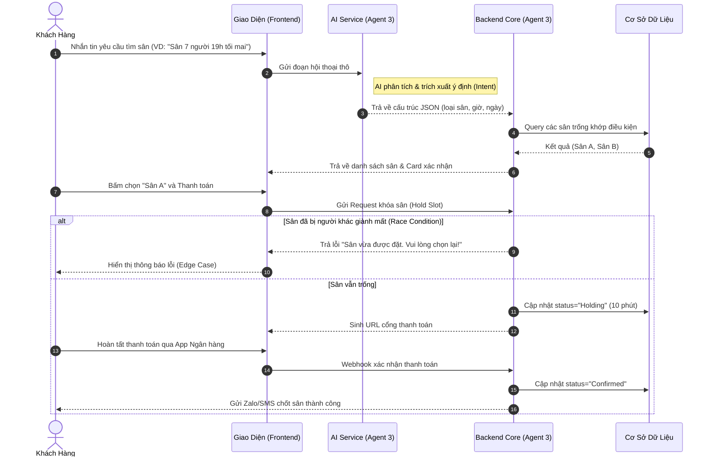

# Tài liệu Đặc tả Yêu cầu (SRS)
**Dự án:** Hệ Thống Quản Lý Sân Thể Thao Tích Hợp AI
**Tác giả:** Requirement & Domain Analyst (BA Agent)

---

## 1. Phân tích Điểm Mờ & Câu hỏi nghiệp vụ (Ambiguities)
*Là một BA, khi nhận yêu cầu "Hệ thống quản lý sân có AI", tôi nhận thấy có những điểm mơ hồ sau cần được Business Owner làm rõ:*

- **[Điểm mờ 1 - Xung đột thời gian thực]:** Điều gì xảy ra nếu hai khách hàng cùng lúc đang trò chuyện với AI hoặc cùng thao tác trên màn hình UI để chốt cùng một khung giờ của cùng một sân? *(Đề xuất: Cần cơ chế khóa giữ chỗ tạm thời trong vòng 5-10 phút khi user bắt đầu bước thanh toán).*
- **[Điểm mờ 2 - Rủi ro AI Hallucination]:** AI có quyền tự động chốt đơn và trừ tiền không? Nếu AI "ảo giác" (hallucination) hứa với khách một mức giá sai thì sao? *(Đề xuất: AI chỉ làm nhiệm vụ trích xuất ý định (Intent) thành file JSON. Việc tra cứu giá và tạo đơn phải do Backend Logic cứng thực thi để đảm bảo tính chính xác tuyệt đối).*
- **[Điểm mờ 3 - Định giá động (Dynamic Pricing)]:** Tiêu chí nào quyết định việc tăng/giảm giá? Nếu khách hàng xem giá lúc 14:00 nhưng 14:30 mới thanh toán, giá có thay đổi giữa chừng làm khách khó chịu không? *(Đề xuất: Cần cơ chế "Freeze Price" - giá được chốt cứng trong suốt phiên chat/đặt sân của user).*
- **[Điểm mờ 4 - Chính sách Hủy & Hoàn tiền]:** Hủy trước bao nhiêu tiếng thì được hoàn 100% cọc? AI có được quyền tự động xử lý yêu cầu hủy sân không?

---

## 2. Danh sách Luồng Ngoại Lệ & Edge Cases
*Đây là các tình huống bất thường hệ thống bắt buộc phải xử lý để không bị lỗi hoặc trải nghiệm tồi tệ:*

- **[Edge Case 1 - Sân bảo trì đột xuất]:** Sân hỏng đèn/rách lưới đột xuất. Chủ sân đánh dấu "Bảo trì" nhưng khung giờ đó đã có khách đặt trước. **->** *Hệ thống phải tự động nhắn tin thông báo hủy/hoàn tiền hoặc gợi ý đổi sân ngay lập tức.*
- **[Edge Case 2 - Vượt quá thời gian giữ chỗ (Timeout)]:** Khách hàng tạo đơn, hệ thống khóa sân chờ thanh toán nhưng khách thoát trang hoặc app ngân hàng bị lỗi. **->** *Backend phải có Background Job tự động nhả slot sân (Unlock) sau đúng 10 phút chờ.*
- **[Edge Case 3 - AI Dịch vụ bị sập/Quá tải]:** API của Gemini/OpenAI bị gián đoạn. **->** *Hệ thống không được sập theo, phải tự động Fallback hiển thị form đặt sân điền tay truyền thống.*
- **[Edge Case 4 - Khách đặt khung giờ lẻ, không hợp lệ]:** Khách chat với AI: "Cho anh đá từ 17h15 đến 18h20". Khung giờ này làm sân bị vỡ vụn thời gian. **->** *AI phải từ chối khéo léo và đề xuất làm tròn thành block 17h00 - 18h30 hoặc 17h30 - 18h30.*

---

## 3. Danh sách User Stories
*Các yêu cầu tính năng phân rã theo chuẩn Agile INVEST.*

### Tính năng: Chatbot Đặt sân Thông minh (AI Booking)
- **User Story:** Là một *Khách hàng*, tôi muốn *nhắn tin bằng ngôn ngữ tự nhiên với AI* để *hệ thống tự động tìm sân trống và báo giá mà tôi không phải tự tra cứu thủ công trên lịch*.
- **Definition of Done (DoD):**
  - AI bóc tách chính xác được: Loại sân, Ngày đá, Khung giờ mong muốn.
  - UI hiển thị phản hồi từ AI không chỉ là văn bản (text), mà phải trả ra một thẻ xác nhận (Booking Card) với các thông số minh bạch.
  - Khách hàng không thể bị AI qua mặt để đặt sân bị trùng lịch.

### Tính năng: Đặt cọc và Giữ chỗ (Reservation & Payment)
- **User Story:** Là một *Khách hàng*, tôi muốn *thanh toán tiền cọc qua cổng online* để *chốt và giữ sân một cách chắc chắn*.
- **Definition of Done (DoD):**
  - Hệ thống tự động khóa (hold) sân với TTL (Time-To-Live) là 10 phút.
  - Tích hợp cổng thanh toán (VD: VNPay/Momo).
  - Tự động thay đổi trạng thái đơn hàng thành "Đã chốt" (Confirmed) ngay khi nhận được Webhook thanh toán thành công.

### Tính năng: Quản lý Giá sân Linh hoạt (Dynamic Pricing)
- **User Story:** Là một *Chủ sân*, tôi muốn *cài đặt hệ số giá theo khung giờ vàng và cuối tuần* để *hệ thống tự động tính tiền cho khách tối ưu doanh thu*.
- **Definition of Done (DoD):**
  - Chủ sân có thể thiết lập hệ số (VD: 17h-20h nhân 1.5 lần giá gốc).
  - Hóa đơn hiển thị rõ cho khách thấy số tiền gốc và số tiền phụ thu cao điểm.

---

## 4. Sơ đồ Luồng Nghiệp vụ (Mermaid)

